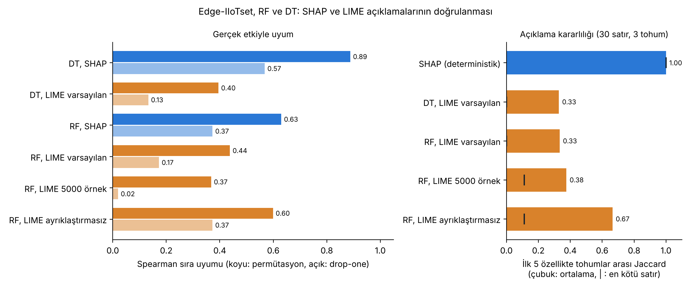
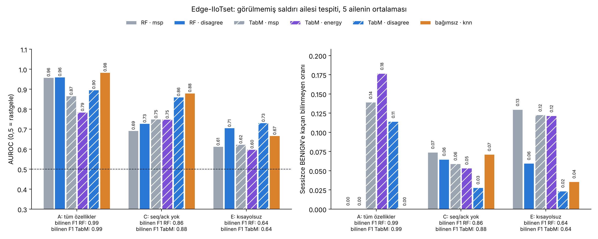
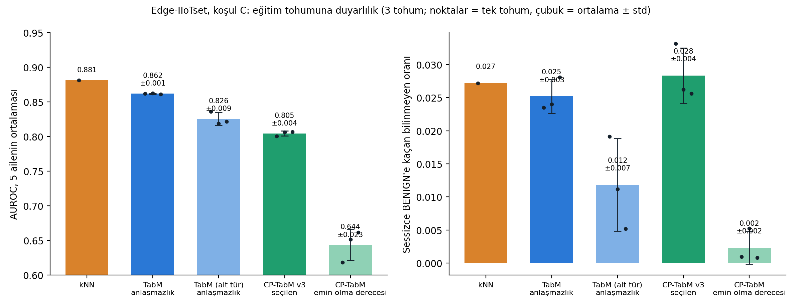
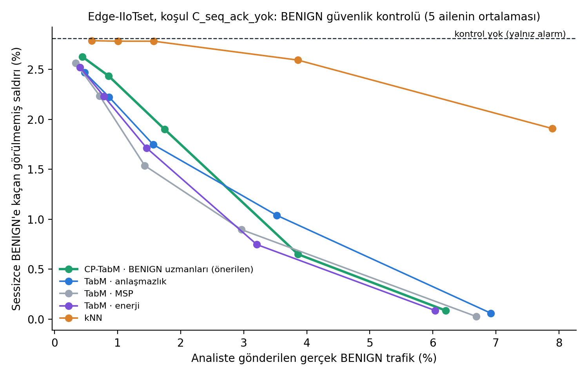
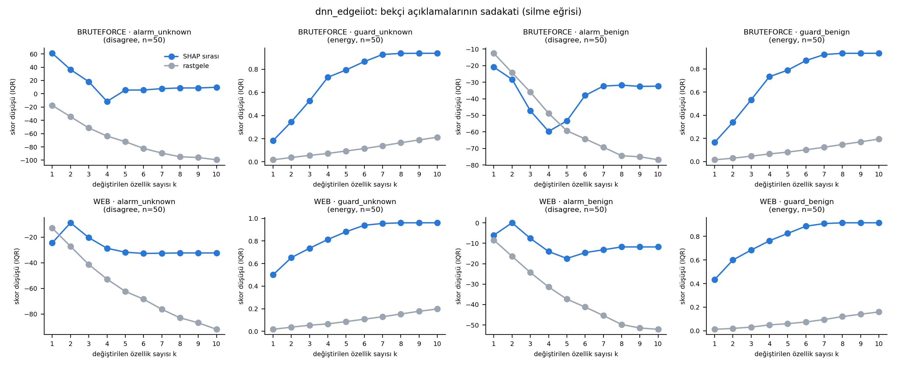
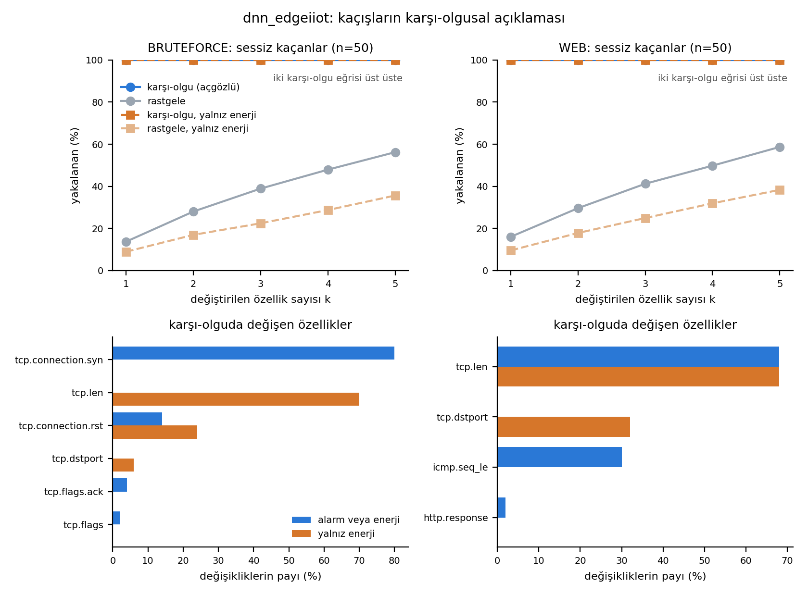
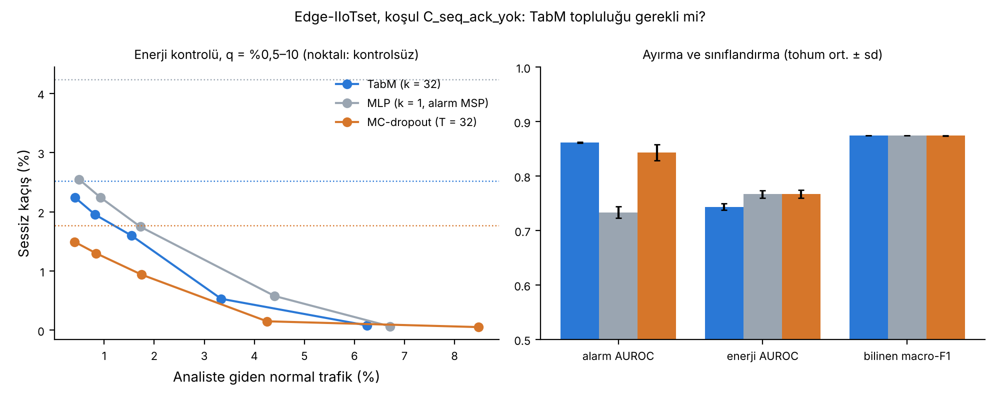

# dnn_edgeiiot: Edge-IIoTset (Kişi 3)

- Kaynak (resmî, yazar hesabı): https://www.kaggle.com/datasets/mohamedamineferrag/edgeiiotset-cyber-security-dataset-of-iot-iiot
- Kullanılan dosya: `Edge-IIoTset dataset/Selected dataset for ML and DL/DNN-EdgeIIoT-dataset.csv` (1,22 GB, 2.219.201 satır, 63 sütun). Arşivin geri kalanı (PCAP'ler, ham CSV'ler, ML dosyası) kullanılmaz.
- Lisans: CC BY-NC-SA 4.0 (akademik kullanım serbest, atıf zorunlu). Dosya Git'e girmez.
- Atıf: M. A. Ferrag, O. Friha, D. Hamouda, L. Maglaras, H. Janicke, "Edge-IIoTset: A New Comprehensive Realistic Cyber Security Dataset of IoT and IIoT Applications for Centralized and Federated Learning," *IEEE Access*, 2022. doi:10.1109/ACCESS.2022.3165809
- Çalışma ortamı: Kaggle Notebooks. Veri not defterine girdi olarak bağlanır, indirilmez (`notebooks/dnn_edgeiiot_kaggle.ipynb`).

Ortam: endüstriyel / edge IoT test düzeneği (7 katman, 10'dan fazla sensör türü, Modbus TCP, MQTT). Satırlar **paket düzeyinde**dir (CICIoT2023 pencere/akış düzeyindedir); bu yüzden özellikler diğer veri setleriyle eşleşmez.

## Etiketler ve ortak kategoriler

| Ortak kategori | Edge-IIoTset etiketleri | Ham satır |
| --- | --- | --- |
| BENIGN | Normal | 1.615.643 |
| DDOS | DDoS_UDP, DDoS_ICMP, DDoS_TCP, DDoS_HTTP | 337.977 |
| WEB | SQL_injection, Uploading, XSS | 104.752 |
| RECON | Vulnerability_scanner, Port_Scanning, Fingerprinting | 73.675 |
| BRUTEFORCE | Password | 50.153 |
| MALWARE | Backdoor, Ransomware | 35.787 |
| SPOOFING | MITM | 1.214 |

Eşleme `src/common/taxonomy.py` içindeki `EDGEIIOT_MAP`'tedir. Not: CICIoT2023'te `BACKDOOR_MALWARE` resmi gruplamada WEB'e gider; Edge-IIoTset'te Backdoor makaledeki "Malware" tehdidine ait olduğu için MALWARE'e eşlendi.

## Veri denetimi (18.10.2026, Aşama 0 not defteri)

**1. Kimlik, zaman ve ham içerik sütunları atılır.** 19 metin sütunu: `frame.time`, IP adresleri (`ip.src_host`, `ip.dst_host`, `arp.*.proto_ipv4`), ham içerik (`tcp.payload`, `http.file_data`, `http.request.full_uri`, `http.request.uri.query`, `tcp.options`, `mqtt.msg`), `tcp.srcport` ve az değerli kategorik alanlar (`http.request.method`, `mqtt.protoname`, `mqtt.topic` vb.). 4 sütun sabit (`icmp.unused`, `http.tls_port`, `dns.qry.type`, `mqtt.msg_decoded_as`).

**2. Sayısal ama kimlik gibi davranan 4 sütun atılır:** `tcp.ack_raw` (ham onay numarası, her bağlantıda rastgele başlar), `tcp.checksum`, `icmp.checksum`, `udp.stream` (kayıt içindeki akış numarası). Kalan: **34 özellik**.

**3. Tek-özellik sızıntı testi** (derinlik 8 karar ağacı, sınıf başına 5.000 satır): tek başına en güçlü özellik `tcp.seq` (macro-F1 0,425), ardından `tcp.ack` 0,421, `tcp.dstport` 0,388, `tcp.len` 0,371; tüm özellikler birlikte 0,538. CICIoT2023'teki `IAT` gibi tek başına sınıfı ele veren bir sütun yok. `tcp.dstport`, `udp.port`, `tcp.seq`, `tcp.ack` kısayol adayı: ablation `--drop-features tcp.dstport,udp.port,tcp.seq,tcp.ack`.

**4-5. Tekrarlar ve etiket çakışması: satır muhasebesi** (19.10.2026'da netleştirildi)

Tanımlar (hepsi 34 özellik üzerinden):
- **Tekrar:** özellikleri VE etiketi birebir aynı olan satırın ikinci ve sonraki kopyaları. Bunlar hatalı kayıt olmak zorunda değildir; sel saldırılarında aynı başlığa sahip binlerce meşru paket vardır. Silinme nedeni: aynı vektörün kopyaları hem eğitime hem teste düşüp skoru şişirmesin.
- **Etiket çakışması:** aynı özellik vektörünün birden fazla farklı ince etiketle görünmesi. Model bu satırları ayırt edemez; etiketler paket bazında değil kayıt dosyası bazında verildiği için saldırı kayıtlarına karışan sıradan paketler saldırı etiketi almıştır. Çakışan grubun tüm satırları atılır (`--drop-conflicts`).

Sayılar işlem sırasına bağlıdır; iki sıra da aynı veri üzerinde doğrudur:

| Sıra | Adım | Kalan satır | Atılan |
| --- | --- | --- | --- |
| Asıl deney (`model_dnn_edgeiiot.py`) | Ham | 2.219.201 | |
| | Tekrarlar silindi | 688.640 | 1.530.561 (**%69,0**) |
| | Çakışan satırlar atıldı | 675.675 | 12.965 (%1,9) |
| Aşama 0 not defteri | Ham | 2.219.201 | |
| | Çakışan satırlar atıldı (kopyalar dahil sayıldı) | 2.022.583 | 196.618 |
| | Tekrarlar silindi | 675.656 | 1.346.927 (ham verinin %60,7'si) |

Raporlanacak tekrar oranı asıl deneydeki **%69,0**'dır. Aşama 0'daki "%61", çakışmalar önce atıldığı için daha düşük çıkmıştır. 196.618 ile 12.965 aynı olguyu iki farklı sırada sayar: ilki her kopyayı ayrı sayar, ikincisi tekrarlar silindikten sonraki tekil satırları (iki sıranın sonunda kalan satır sayısı 19 satır farkla aynıdır).

Kimlik gibi davranan 4 sütun (38 özellik) varken çakışma (tekrarlar silinmeden) yalnızca 21.486 satırdı: o sütunlar modelin ayırt edilemeyen paketleri "ezberlemesini" sağlıyordu.

Hangi etiketler çakışıyor, sıraya göre değişir:
- **Kopyalar dahil sayılınca (Aşama 0)** en çok MITM etkileniyor (1.214 satırın 821'i): ARP paketleri normal ARP trafiğinden ayırt edilemiyor.
- **Tekil satırlar sayılınca (asıl deney, 12.965 satır):** Password 3.273, Normal 2.751, Uploading 1.990, SQL_injection 1.716, XSS 1.152, DDoS_HTTP 985, Ransomware 579, Vulnerability_scanner 430; MITM yalnızca 1. Yani tekil düzeyde çakışma çoğunlukla HTTP/TCP tabanlı saldırılarla normal trafik arasında: aynı bağlantıdaki el sıkışma ve onay paketleri saldırıya özgü değil.

**6. Temizlik sonrası nadir sınıflar:** MITM 357, Fingerprinting 181 satır.

**7. Sütunları kaymış satırlar: DDoS_UDP ve MITM (19.10.2026).** Bu iki saldırının satırlarında sütunlar kaymış:
- **DDoS_UDP:** `frame.time`'da saldırganın (sahte) IP'si, `ip.src_host`'ta hedef IP, `ip.dst_host`'ta 0 var; UDP flood portu `udp.port` yerine `tcp.srcport`'ta. En azından baştaki sütunlar bir sola kaymış.
- **MITM (ARP zehirleme):** `frame.time`'da "6.0", ARP alanlarının hepsi sıfır, bazı satırlarda `udp.port`/`tcp.srcport`'ta mDNS metni (`_ipp._tcp.local`).

Kayma yayımlanan **DNN, ML ve ham "Attack traffic" CSV'lerinin hepsinde** aynı, dolayısıyla düzgün bir kaynak yok. Sütun sayısı (63) ve etiketler yerinde olduğu için kaymanın nerede bittiği tek satırdan çıkarılamıyor; tahminle hizalamak güvenilir değil. Diğer 13 türde ve Normal'de `frame.time` her satırda geçerli bir zaman damgası.

Sonuç: model bu iki türü saldırının kendisinden değil, "neredeyse tamamı sıfır, düzeni bozuk satır" kalıbından tanıyordu (MITM her koşulda, kısayolsuz modelde bile F1 = 1,0). **Hizasız satırlar `frame.time` biçimine bakılarak bulunur ve atılır** (`misaligned_mask`, ham veride DDoS_UDP 121.568 + MITM 1.214 = 122.782 satır, %5,53). DDOS kategorisi üç alt türle (HTTP, ICMP, TCP) devam eder; **SPOOFING kategorisi bu veri setinde yoktur.** Duyarlılık analizi için `--keep-misaligned`. Düzeltme yolu olarak ileride MITM'in PCAP kaydından yeniden özellik çıkarılabilir.


## Sonuçlar (19.10.2026, temiz veri, asıl deney)

Ayarlar: `--drop-conflicts --tune --shap --gpu`; hizasız satırlar atıldı; etiket başına en fazla 40.000 satır; stratified 80/20 (seed=42); 5-fold OOF; 30 deneme / 200 bin satırlık ayar araması (Kişi 1 ile aynı protokol); tahminler **tüm test kümesinde** (59.302 satır). Kaggle, GPU (T4). 18.10.2026 sonuçları hizasız satırlar veride iken alınmıştı ve geçersizdir (yerlerini bu bölüm aldı).

**Veri hazırlama:** ham 2.219.201 → hizasız 122.782 satır atıldı → tekrarlar silindikten sonra 676.748 → çakışan 12.963 satır atıldı → örneklem **296.506 satır**, 34 özellik, **6 kategori** (SPOOFING yok). Eğitim 237.204, test 59.302.

**Test kümesinin kullanımı:** hiperparametre araması yalnızca eğitim kümesinin alt örnekleminde 3-fold CV ile yapılır, DSS güvenilirlik ağırlıkları eğitim kümesinin 5-fold OOF tahminlerinden gelir. Test kümesi yalnızca son değerlendirmede kullanılır.

| Model | OOF macro-F1 | Test macro-F1 | Eğitim (s) | Tahmin (ms/1k) | Seçilen ayarlar |
| --- | --- | --- | --- | --- | --- |
| **RF** (birincil) | 0,9941 | **0,9940** | 24,6 | 5,0 | 200 ağaç, derinlik 40, max_features 0,5, min_samples_leaf 2 |
| DT | 0,9938 | 0,9938 | 0,7 | 0,1 | sınırsız derinlik, gini, min_samples_leaf 2 |
| XGB | 0,9919 | 0,9924 | 8,3 (GPU) | 2,7 | derinlik 4, lr 0,2; early stopping 603 ağaç |
| TabM | 0,9915 | 0,9905 | 465 (GPU) | 20,5 | k=32, PLE gömmeleri, ayar araması yok; early stopping 37 epoch |
| LGBM | 0,9911 | 0,9902 | 12,8 | 25,9 | 63 yaprak, lr 0,05; early stopping 145 ağaç |
| LR | 0,7453 | 0,7453 | 43,7 | 0,6 | C = 1 |

RF test F1 (sınıf): BENIGN 0,9996 · RECON 0,9967 · BRUTEFORCE 0,9899 · **WEB 0,9852** · MALWARE 0,9993 · DDOS 0,9930. İnce etiket recall'ı 0,99'un altında olanlar: DDoS_HTTP 0,952, Fingerprinting 0,889.

**DSS (tüm test kümesi):** oylayanlar DT, RF, XGB, LGBM, TabM (LR elendi); macro-F1 **0,9941**. İkili NIDS bakışı: tespit oranı %100,0, yanlış alarm %0,00, kaçırılan saldırı 2 (yaklaşık 51 bin saldırıdan). Aksiyonlar: BLOCK 27.119, ALERT 23.393, ALLOW 7.991, LOG_MONITOR 775, ANALYST_REVIEW 24; **ALLOW edilen saldırı: 1**.

**Bulgular:**

1. **Aşırı uyum yok:** OOF ve test skorları her modelde çok yakın.
2. **TabM**, ayar araması olmadan LGBM ile aynı seviyede, RF'nin binde 3,5 gerisinde. Ekibin durma kuralı (ağırlıksız doğrulama kaybı) TabM'de de doğrulandı: kayba ve doğrulama macro-F1'ine göre en iyi epoch'lar arasında macro-F1 farkı en fazla ~0,001.
3. **En zayıf kategori WEB** (0,985): DDoS_HTTP (recall 0,952) WEB ile karışıyor; içerik sütunları atıldığı için model yalnızca başlık alanlarını görüyor.
4. **SHAP (RF):** her sınıfta en önemli üç özellik neredeyse aynı: `tcp.ack`, `tcp.dstport`, `tcp.seq` (DDOS'ta `tcp.flags`). Sınıfa özgü bir açıklama yok; bkz. ablation ve zaman bölmesi.

## Kısayol özellik ablation deneyi (19.10.2026, temiz veri)

Kod: `src/ablation_dnn_edgeiiot.py`, çıktı: `outputs/dnn_edgeiiot/ablation/`. Protokol: asıl deneydeki satırlar ve aynı 80/20 bölme (seed=42); RF ve DT sabit hiperparametrelerle; yalnızca sütunlar çıkarılır; %95 güven aralıkları 300 bootstrap.

| Senaryo | Çıkarılan | RF test macro-F1 (%95 GA) | DT | Fark (RF) | Başka kategoriyle aynı vektöre düşen satır |
| --- | --- | --- | --- | --- | --- |
| A: Tam | – | 0,9932 (0,9925–0,9939) | 0,9932 | | %0 |
| B: Portsuz | `tcp.dstport`, `udp.port` | 0,9570 (0,9554–0,9586) | 0,9561 | −0,036 | %13,4 |
| C: Sıra/onay yok | `tcp.seq`, `tcp.ack` | 0,8239 (0,8206–0,8270) | 0,8533 | −0,169 | %22,2 |
| D: Sayaç/zaman yok | `mbtcp.trans_id`, `icmp.transmit_timestamp` | 0,9932 (0,9925–0,9938) | 0,9931 | 0,000 | %0 |
| E: Hepsi | 6 sütun | **0,6175** (0,6133–0,6215) | 0,6169 | **−0,376** | **%59,2** |

**Bulgular:**

1. **Yüksek skorun büyük kısmı dört alandan geliyor.** Port ve TCP sıra/onay numaraları çıkınca macro-F1 0,993'ten 0,618'e iniyor; satırların %59'u başka bir kategorideki bir satırla birebir aynı hâle geliyor.
2. **En büyük katkı `tcp.seq`/`tcp.ack`'tan (−0,169), sonra portlardan (−0,036).** Bunlar Wireshark'ın göreli değerleri (bağlantı içindeki konum); kimlik sızıntısı değil, saldırı aracına ve kayıt düzenine bağlı **bağlama özgü kısayol**.
3. **E'de en çok çöken sınıflar:** BRUTEFORCE (F1 0,35), WEB (0,40), MALWARE (0,64), BENIGN (0,70; Normal recall 0,57 → çok sayıda yanlış alarm). İnce etiketlerde XSS (recall 0,20), Uploading (0,22), SQL_injection (0,31), DDoS_HTTP (0,37). Bu saldırıların paketleri aynı HTTP/TCP bağlantılarının sıradan paketleriyle aynı başlığa sahip (Backdoor %98, Ransomware %100, Password %84, Uploading %86 çakışma).
4. **Şüpheli iki sütun temiz:** `mbtcp.trans_id` (22 farklı değer) ve `icmp.transmit_timestamp` (84) tek başına şans düzeyinde (macro-F1 0,11); çıkarmak sonucu değiştirmiyor (D).
5. **Temizlik bulguyu güçlendirdi:** hizasız satırlar veride iken E'de RF 0,675 idi; MITM'in her koşulda F1 = 1,0 alması skoru yapay olarak yükseltiyordu.

## Zaman bazlı bölme kontrolü (19.10.2026, temiz veri)

Kod: `src/split_check_dnn_edgeiiot.py`, çıktı: `outputs/dnn_edgeiiot/split_check/`. Aynı satırlar ve sabit hiperparametreler. **Rastgele:** ince etikete göre stratified 80/20, her seed farklı bölme. **Zaman:** her ince etiketin kayıt sırasına (CSV satır sırası) göre ilk %80'i eğitim, son %20'si test. `frame.time`'da tarih yok (yalnızca günün saati); kayıt sırası ile saat sırası 11 etikette tamamen aynı (Spearman ρ = 1,0), Normal (0,88) ve Ransomware (0,11) gece yarısını geçtiği için satır sırası kullanılır. `frame.time` hiçbir zaman özellik değildir. 5 seed.

| Koşul | Model | Rastgele | Zaman | Fark | Yanlış alarm (rastgele → zaman) | Kaçırılan saldırı (zaman) |
| --- | --- | --- | --- | --- | --- | --- |
| A (34 özellik) | RF | 0,9937 ± 0,0002 | **0,9237 ± 0,0129** | −0,070 | %0,01 → **%3,9** | %0,00 |
| A (34 özellik) | DT | 0,9934 ± 0,0002 | **0,8943 ± 0,0008** | −0,099 | %0,03 → **%4,0** | %0,00 |
| E (kısayolsuz) | RF | 0,6157 ± 0,0014 | 0,6204 ± 0,0001 | +0,005 | %43,1 → %42,0 | %1,2 |
| E (kısayolsuz) | DT | 0,6149 ± 0,0014 | 0,6191 ± 0,0000 | +0,004 | %43,1 → %42,1 | %1,4 |

**Bulgular:**

1. **Rastgele bölme iyimser.** Geçmişle eğitilip "gelecekteki" trafikte denenince 34 özellikli modelin macro-F1'i 0,07–0,10 düşüyor, yanlış alarm oranı yüzlerce kat artıyor (%0,01 → %3,9).
2. **Kaybın tamamı kısayol alanlarından.** Kısayolsuz model zaman bölmesinde kaybetmiyor. Port ve TCP sıra/onay değerleri kayıt ilerledikçe değişiyor; model geçmişteki değerleri ezberlemiş. Ablation ile bağımsız iki kanıt aynı sonucu veriyor.
3. **Güvenlik açısından:** iki koşulda da saldırılar neredeyse hiç kaçırılmıyor; sorun yanlış alarm.

**Karar:** Ana deneyler A (34 özellik) ile yapılır (literatür ve ekip ile karşılaştırılabilirlik); E "kısayolsuz" sağlamlık koşulu olarak bilinmeyen saldırı deneylerinde de raporlanır. Sınırlılık: veri paket düzeyinde; akış düzeyinde özellikler yalnızca arşivdeki ham kayıtlardan çıkarılabilir.

## Maliyet analizi (19.10.2026)

Kod: `src/cost_dnn_edgeiiot.py`, çıktı: `outputs/dnn_edgeiiot/cost/`. Asıl deneyin modelleri yeniden eğitilmeden yüklendi; **hepsi CPU tek çekirdekte** ölçüldü (adil karşılaştırma; GPU'suz edge cihazı için yaklaşık gösterge), XGB ve TabM için ayrıca GPU (T4). Toplu tahmin: 10.000 test satırı, 3 tekrarın medyanı; tek paket: 300 tekil tahminin medyanı.

| Model | Test F1 | Boyut | Eğitim | Toplu (ms / 1.000) | Saniyede paket (1 çekirdek) | Tek paket (ms) | GPU toplu (ms / 1.000) |
| --- | --- | --- | --- | --- | --- | --- | --- |
| DT | 0,9938 | 0,4 MB | 0,7 s | 0,17 | ~5,8 milyon | 0,9 | – |
| RF | 0,9940 | 53,2 MB | 24,6 s | 15,8 | ~63 bin | 12,0 | – |
| XGB | 0,9924 | 5,1 MB | 8,3 s (GPU) | 45,9 | ~22 bin | 2,2 | 3,0 |
| LGBM | 0,9902 | 6,1 MB | 12,8 s | 78,8 | ~13 bin | 0,8 | – |
| TabM | 0,9905 | 3,0 MB | 465 s (GPU) | 689 | ~1,5 bin | 10,7 | 20,5 |

**DSS oylayıcıları** (5 modelin 31 alt kümesi; seçim yalnızca OOF macro-F1 ile, test yalnızca raporlama):

| Oylayıcılar | OOF | Test | ALLOW edilen saldırı | Yanlış alarm | Toplu (ms / 1.000) |
| --- | --- | --- | --- | --- | --- |
| Şu anki kural (DT+RF+XGB+LGBM+TabM) | 0,9941 | 0,9941 | 1 | %0,00 | 830 |
| **DT+RF+XGB** (OOF'ta en iyi) | **0,9944** | **0,9946** | 1 | %0,00 | **62** |
| DT (önceden konan "OOF'ta en iyiye ≤0,001 yakın, en hızlı" kuralı) | 0,9938 | 0,9938 | 2 | %0,04 | 0,2 |

**Bulgular:**

1. **DT neredeyse aynı başarıyı ~100 kat daha ucuza veriyor**; kısayol bulgusuyla tutarlı (birkaç alanla karar verilebiliyor).
2. **TabM CPU'da en pahalı model** (RF'nin ~40 katı), GPU'da 34 kat hızlanıyor; model boyutu ise en küçüklerden (3 MB). GPU'suz edge cihazları için bu ödünleşim CP-TabM tartışmasında yazılmalı.
3. **DSS için öneri: DT+RF+XGB.** OOF ve testte en iyi, şu anki kuraldan 13 kat ucuz; farklar binde 1'in altında olduğu için doğru ifade "başarı ve güvenlik değişmeden maliyet 13 kat düşüyor". TabM'in rolü sınıflandırma oylaması değil, görülmemiş saldırı tespiti. Ortak DSS kuralını değiştirdiği için ekip kararı gerekiyor.
4. Sınırlılık: ölçümler Kaggle'da; gerçek bir edge cihazında ölçülmedi.

## Açıklama Doğrulama: SHAP ve LIME (20.10.2026)

Kod: `src/xai_faithfulness_dnn_edgeiiot.py` (özet grafik: `src/xai_faithfulness_summary_dnn_edgeiiot.py`), çıktı: `outputs/dnn_edgeiiot/xai_faithfulness/`. Soru: SHAP ve LIME'ın "önemli" dediği özellikler, modelden gerçekten çıkarıldığında başarıyı düşürenlerle aynı mı? Açıklamalar her alarmda analiste gösterileceği için doğru olmaları gerekir.

**Yöntem.** Temiz veri, tam koşul (A), RF ve DT (ablation ayarları, test macro-F1 0,9932 / 0,9932). Gerçek etki iki şekilde ölçüldü: **drop-one** (her özellik çıkarılıp model yeniden eğitilir, macro-F1 kaybı) ve **permütasyon** (özellik karıştırılır, kayıp). Açıklama yöntemleri: **SHAP** TreeExplainer (sınıf başına 100 test satırı, |değer| ortalaması) ve **LIME** (sınıf başına 50 satır, tahmin edilen sınıf için |ağırlık|). Uyum Spearman/Kendall ve ilk-k Jaccard ile; LIME kararlılığı 30 satırın 3 farklı tohumla yeniden açıklanmasıyla ölçüldü. LIME'ın ayara bağlı olup olmadığını görmek için RF'de iki ek koşu yapıldı (5000 örnek; ayrıklaştırma kapalı; drop-one değerleri ilk koşudan alındı).



| Spearman (ilk-5 Jaccard) | DT | RF | RF, LIME 5000 | RF, LIME ayrıklaştırmasız |
| --- | --- | --- | --- | --- |
| SHAP ~ permütasyon | **0,89 (1,00)** | **0,63 (0,67)** | – | – |
| SHAP ~ drop-one | 0,57 (0,67) | 0,37 (0,67) | – | – |
| LIME ~ permütasyon | 0,40 (0,43) | 0,44 (0,67) | 0,37 (0,43) | 0,60 (0,43) |
| LIME ~ drop-one | 0,13 (0,43) | 0,17 (0,43) | 0,02 (0,43) | 0,37 (0,67) |
| SHAP ~ LIME | 0,40 | 0,75 | 0,55 | 0,88 |
| LIME kararlılığı: ilk-5 Jaccard ort. (en kötü) | 0,33 (0,00) | 0,33 (0,00) | 0,38 (0,11) | 0,67 (0,11) |

**Bulgular:**

1. **SHAP iki modelde de gerçek etkiyle en uyumlu yöntem** ve deterministik (aynı satır her zaman aynı açıklamayı alır). DSS'de analiste gösterilecek açıklamalar için SHAP seçildi.
2. **LIME yapılandırmaya duyarlı.** Varsayılan (ayrıklaştırmalı) LIME bu veride kararsız (tekrarlarda ilk 5 özelliğin ancak üçte biri korunuyor) ve modelin kullanmadığı alanları (`mqtt.*`, `dns.*`) öne çıkarabiliyor. Örnek sayısını 5000'e çıkarmak düzeltmiyor; **ayrıklaştırmayı kapatmak** düzeltiyor (kararlılık 0,67, SHAP ile uyum 0,88). Olası sebep: çoğu sütun neredeyse hep 0, çeyrek sınırları anlamsızlaşıyor.
3. **İyi ayarlı LIME bile satır bazında kararsız** (en kötü satırda ilk 5'ten yalnızca 1 ortak; ağırlık sıralaması uyumu 0,40). Bu yüzden LIME tamamlayıcı olarak raporlanır, birincil açıklama SHAP'tır.
4. **Drop-one, birbirinin yerini tutan özellikleri küçük gösterir** (`tcp.seq`/`tcp.ack`; RF'de başka ağaçlar telafi ediyor). Bu yüzden permütasyon ikinci referans olarak kullanıldı; SHAP'ın drop-one uyumunun daha düşük olması bu kör noktadan.
5. **Kısayol bulgusu dört yöntemde de aynı:** ilk üç özellik `tcp.ack`, `tcp.dstport`, `tcp.seq` (ablation ve zaman bölmesi bulgularıyla tutarlı).
6. Sınırlılık: yalnızca tam koşulda (A) ve ağaç modelleriyle yapıldı; kısayolsuz koşul (E) ve TabM açıklamaları sonraki adım.

## Görülmemiş saldırı deneyi: temel skorlar (20.10.2026)

Kod: `src/open_set_lofo_dnn_edgeiiot.py` (özet grafik: `src/open_set_summary_dnn_edgeiiot.py`), çıktı: `outputs/dnn_edgeiiot/open_set/`. Toplantı kararıyla deney her kişinin kendi dalında yürütülüyor.

**Protokol (leave-one-family-out).** Ekip bölmesi (80/20, ince etikete göre katmanlı, seed 42) aynen kullanılır. Her turda bir saldırı ailesi (DDOS, RECON, WEB, BRUTEFORCE, MALWARE) eğitimden tamamen çıkarılır; kalan eğitim verisi %90 eğitim / %10 kalibrasyon. Test kümesi asıl deneyle aynıdır; çıkarılan ailenin satırları "bilinmeyen" sayılır. **Eşik yalnızca kalibrasyondaki bilinen satırlarla seçilir** (bilinenlerin %95'i kabul); bilinmeyen aileden hiçbir bilgi kullanılmaz. Koşullar ablation'daki gibidir ve satırlar her koşulda aynıdır (yalnızca sütunlar değişir): **A** tüm 34 özellik, **C** `tcp.seq`/`tcp.ack` çıkarılmış, **E** port, seq/ack ve şüpheli kimlik alanları çıkarılmış.

**Skorlar** (büyük = bilinmeyen): `msp` (1 − en yüksek olasılık), `entropy`, `disagree` (topluluk üyeleri arası karşılıklı bilgi; RF'de 100 ağaç, TabM'de 32 üye), `energy` (TabM, −logsumexp(logit)), `knn` (bilinen eğitim verisinde 5 en yakın komşuya uzaklık, modelden bağımsız).



| 5 ailenin ortalaması, AUROC | A: tüm özellikler | **C: seq/ack yok (ana)** | E: kısayolsuz |
| --- | --- | --- | --- |
| Bilinen sınıflarda macro-F1: RF / TabM | 0,99 / 0,99 | 0,86 / 0,88 | 0,64 / 0,64 |
| RF msp / disagree | 0,96 / 0,96 | 0,69 / 0,73 | 0,61 / 0,71 |
| TabM msp / energy | 0,87 / 0,79 | 0,75 / 0,75 | 0,62 / 0,60 |
| **TabM disagree** | 0,90 | 0,86 | **0,73** |
| kNN | **0,98** | **0,88** | 0,67 |
| Sessizce BENIGN'e kaçan: TabM msp / TabM disagree | %14 / %11 | %6 / **%3** | %12 / **%2** |

Aile bazında C (AUROC, TabM disagree / kNN): DDOS 0,78 / **0,91**, RECON **0,90** / 0,89, WEB **0,88** / 0,87, BRUTEFORCE 0,86 / 0,86, MALWARE **0,89** / 0,88.

**Bulgular:**

1. **Standart güven skorları (msp, entropi, enerji) görülmemiş saldırıda aşırı özgüven yüzünden başarısız.** Kısayollar azaldıkça rastgeleye iniyor; E'de görülmemiş DDOS'ta rastgeleden kötü (TabM energy 0,38): model bilinmeyene bilinenlerden daha emin.
2. **En güçlü model içi sinyal topluluk üyelerinin anlaşmazlığı.** İki modelde, üç koşulda ve hemen her ailede msp/enerjiden iyi; sessiz BENIGN kaçışını belirgin azaltıyor (C'de %6 → %3, E'de %12 → %2; E'de görülmemiş MALWARE'de %40 → %0,1). CP-TabM'in dayandığı varsayım için güçlü kanıt.
3. **kNN'nin üstünlüğü kısayollardan geliyor.** A'da görülmemiş ailelerin sayaç/port değerleri eğitim aralığının dışında, uzaklık hemen büyüyor (0,98). C'de TabM anlaşmazlığı 5 ailenin 4'ünde kNN'ye eşit veya iyi; ortalama farkın tamamı DDOS'tan. E'de kNN WEB ve BRUTEFORCE'ta rastgele (0,51 / 0,50) ve ortalamada TabM anlaşmazlığının gerisinde (0,67 / 0,73). Ayrıca kNN eğitim verisini saklamayı ve her pakette uzaklık hesabını gerektirir.
4. **"Bilinende en iyi model, bilinmeyende en güvenli model değildir."** A'da TabM bilinen sınıflarda 0,99 F1'e rağmen görülmemiş MALWARE'in %86'sını BENIGN sanıyor; en iyi skorla bile %53'ü sessizce kaçıyor, energy AUROC 0,41. Aynı aile RF'de %100 yakalanıyor. Olası neden (hipotez): sinir ağlarının veri dışı bölgede aşırı özgüveni ve QuantileTransformer'ın aralık dışı değerleri sınıra sıkıştırması. C'de aynı TabM bu aileyi sessiz kaçış %0 ile yakalıyor.
5. **Ana koşul C.** `tcp.seq`/`tcp.ack` göreli sayaçtır (ezber); hedef port gerçek ağlarda anlamlıdır. A iyimser üst sınır, E en sert dayanıklılık testi; E'de bilinen sınıflar bile ayrılamıyor (F1 0,64).
6. **CP-TabM için hedefler:** (i) bilinen bir sınıfa güçlü benzeyen bilinmeyenler (C'de görülmemiş DDOS'un %76'sı güvenle RECON sanılıyor; TabM 0,78, kNN 0,91), (ii) BRUTEFORCE'taki kalıcı sessiz BENIGN kaçışı (C'de hangi skorla olursa olsun ~%12), (iii) A'daki MALWARE → BENIGN türü aşırı özgüven, (iv) "bilinmeyen" kararının açıklanabilmesi.
7. Notlar: "BENIGN'e kaçan" sınıf tahminini veren modele bağlıdır (kNN yalnız bilinmeyen kararı verir; satırı yanındaki modelin tahminiyle hesaplanır). msp'de E'de "yakalanan %0" hata değildir: bilinenlerin kendisi çok belirsiz olduğundan %95 eşiği en yüksek belirsizlik değerine oturur. RF'de saf yapraklı turlarda `disagree` entropiyle aynıdır.

### Başarı ölçütleri (sonuçlardan ÖNCE belirlendi, 20.10.2026)

CP-TabM, ana koşul **C**'de, 5 ailenin ortalamasıyla, **en iyi temel skorla** (RF ve TabM skorları ile kNN dahil; şu an kNN 0,88, ardından TabM disagree 0,86) karşılaştırılır. Tüm ayarlar yalnızca kalibrasyon verisiyle seçilir; beş ailenin hepsi raporlanır; sonuçlar en az 3 tohumla verilir.

| Sonuç | Ölçüt |
| --- | --- |
| **Açık başarı** | AUROC'ta en iyi temel skordan **en az +0,05**, sessiz BENIGN kaçışında belirgin düşüş (yaklaşık yarıya), bilinen sınıflarda macro-F1 kaybı sade TabM'e göre **en fazla 0,01**; fark tohumlar arası sapmadan büyük |
| **Kısmi başarı** | Ortalamada küçük fark (+0,01–0,05) ama en zor ailelerde (WEB, MALWARE, BRUTEFORCE) ya da sessiz BENIGN kaçışında belirgin iyileşme |
| **Başarısız** | Temel skorlarla aynı veya daha kötü; ya da tespit artarken bilinen başarı belirgin düşüyor. Bu durumda sonuç ve olası nedenleri olduğu gibi raporlanır |

Bileşen testleri: sınıflara bölünmüş üyeler, enerji farkı kaybı ve imza tutarlılığı skoru teker teker çıkarılır; ölçülebilir katkısı olmayan bileşen raporda belirtilir.

### Sonuç ve 3 tohum doğrulaması (21.10.2026, koşul C)

Kod: `src/cp_tune_dnn_edgeiiot.py` (iç prova, ayar seçimi), `src/open_set_lofo.py --model-seed 1|2 --cp-config ...` (ek tohumlar), `src/seed_check_dnn_edgeiiot.py` (özet). Çıktı: `outputs/dnn_edgeiiot/cp_tune/`, `outputs/dnn_edgeiiot/seeds/` (s1, s2 ve özet). Veri bölmesi sabit (seed 42); yalnızca model eğitim tohumu değişir (42, 1, 2).



| 5 ailenin ortalaması, 3 tohum | AUROC | Sessiz BENIGN kaçışı | Yakalanan (kal. eşiği) | Bilinen macro-F1 |
| --- | --- | --- | --- | --- |
| **TabM · üye anlaşmazlığı** | **0,862 ± 0,001** | %2,5 ± 0,3 | %48,9 | 0,875 |
| TabM (alt tür etiketleriyle) · anlaşmazlık | 0,826 ± 0,009 | %1,2 ± 0,7 | %42,4 | 0,877 |
| CP-TabM v3 · iç provayla seçilen | 0,805 ± 0,004 | %2,8 ± 0,4 | %29,7 | 0,875 |
| CP-TabM · emin olma derecesi | 0,644 ± 0,023 | %0,2 ± 0,3 | %13,1 | 0,875 |
| kNN (model bağımsız, tek koşu) | 0,881 | %2,7 | %54,1 | – |

**Önceden yazılan ölçütlere göre değerlendirme: başarısız.** CP-TabM, en iyi temel skorun (kNN 0,88; TabM anlaşmazlığı 0,86) gerisinde kaldı; "+0,05 AUROC" çıtasının çok altında. En zor ailelerde de belirgin bir üstünlüğü yok. "Emin olma derecesi" skorunun düşük sessiz kaçışı (%0,2) bir iyileşme sayılmaz: bu skor bilinmeyeni zayıf ayırt ediyor (AUROC 0,64) ve kaçışı daha az şeyi "bilinen" kabul ederek düşürüyor. Aynı analist bütçesinde karşılaştırma iki sinyalli kuralda yapıldı (aşağıda) ve orada da TabM'in kendi skorlarından farkı çıkmadı. Bilinen sınıflarda kayıp yok (0,875; ölçüt en fazla 0,01).

**Tohum kararlılığı:** sonuçlar tohumdan neredeyse bağımsız (TabM anlaşmazlığı ±0,001; CP-TabM ±0,004). Sıralama üç tohumda da aynı; fark tesadüf değil.

**Bileşen testleri yapılmadı:** yöntem bütün hâliyle temel skorları geçemediği için bileşenlerin teker teker çıkarılması anlamını yitirdi. Bunun yerine bir varyant denendi (FP-TabM: üyelere farklı özellik maskeleri); ilk iki ailede (DDOS 0,54, RECON 0,71) sade TabM'in gerisinde kaldığı için durduruldu.

**Sonuç:** Edge-IIoTset'te sade TabM'in üye anlaşmazlığı en iyi ve en kararlı model tabanlı skor. Ekip kararıyla (21.10.2026) ana yöntem TabM + iki sinyalli kural oldu; CP-TabM CICIoT2023'e ayar aktarımıyla, tanımlayıcı karşılaştırma olarak taşınıyor.

## İki sinyalli karar kuralı: başarı ölçütleri (sonuçlardan ÖNCE belirlendi, 21.10.2026 18:51)

Kod: `src/two_signal.py`. Akış: TabM sınıflandırır, üye anlaşmazlığı alarm verir; alarm yoksa ve tahmin BENIGN ise bir kontrol skoru trafiği analiste gönderebilir (DSS'te ALLOW yerine ANALYST_REVIEW). Kontrol eşiği, kalibrasyondaki gerçek BENIGN trafiğin yalnızca q kadarını işaretleyecek şekilde seçilir (analist bütçesi). Karşılaştırılan kontroller aynı q'da: CP-TabM BENIGN uzmanları (`cp_benign_z`), TabM anlaşmazlık / MSP / enerji, kNN.

İki soru: (1) BENIGN kontrolü fikri işe yarıyor mu? (2) Bunun için CP-TabM gerekli mi? Ölçüt q = %1'de sessiz BENIGN kaçışı; kaçışın gerçekten görüldüğü ailelerde (özellikle BRUTEFORCE) ve ailelerin ortalamasında.

| Sonuç | Ölçüt |
| --- | --- |
| **Açık başarı** | q = %1'de CP-TabM kontrolü kaçışı kontrolsüz duruma göre en az yarıya indirir VE TabM'in en iyi kontrol skorundan en az %30 daha düşük kaçış verir |
| **Kısmi başarı** | Kontrol fikri işe yarar (kaçış yarıya iner) ama CP-TabM TabM'in kendi skorlarıyla aşağı yukarı aynıdır: kural tezin katkısı olur, CP-TabM'in değil |
| **Başarısız** | Hiçbir kontrol q ≤ %2'de kaçışı belirgin azaltamaz |

Uyarılar: ilk ölçüm tek tohumludur; sınırdaki bir sonuç 3 tohumla doğrulanmadan başarı sayılmaz. Kaçışın olmadığı ailelerde (ör. DDOS) kontrol yalnızca maliyeti (analist yükü) gösterir.

### Sonuç (21.10.2026, tek tohum, koşul C)



Kontrolsüz (yalnız alarm) sessiz BENIGN kaçışı ortalama %2,8; kaçış yalnızca WEB (%2,3) ve BRUTEFORCE (%11,6) ailelerinde var, DDOS, RECON ve MALWARE'de ~%0.

| 5 ailenin ortalaması, sessiz kaçış | q = %1 | q = %2 | q = %5 | q = %10 |
| --- | --- | --- | --- | --- |
| CP-TabM BENIGN uzmanları | %2,43 | %1,90 | **%0,65** | %0,09 |
| TabM MSP | %2,23 | **%1,54** | %0,90 | %0,03 |
| TabM enerji | %2,23 | %1,71 | %0,75 | %0,09 |
| TabM anlaşmazlık | **%2,22** | %1,75 | %1,04 | %0,06 |
| kNN | %2,78 | %2,78 | %2,59 | %1,91 |

**Önceden yazılan ölçütlere göre değerlendirme:**

1. **Ana ölçüt (q = %1) sağlanmadı:** hiçbir kontrol kaçışı yarıya indiremedi (en iyisi %2,8 → %2,2). Bu nedenle sonuç "açık başarı" ya da ölçütteki tanımıyla "kısmi başarı" değildir.
2. **"Başarısız" da değildir:** q = %2'de kaçış belirgin azalıyor (en iyi TabM MSP ile %45). q = %5'te 4 kat (CP-TabM %0,65, TabM enerji %0,75), q = %10'da neredeyse sıfır. Yani BENIGN kontrolü işe yarıyor ama etkili olması için %1'den büyük bir analist bütçesi gerekiyor.
3. **CP-TabM'in ek katkısı yok:** q ≤ %2'de TabM'in kendi skorlarının gerisinde. q = %5'te en iyi (BRUTEFORCE'ta %2,9'a karşı TabM enerji %3,4), ama fark ölçütteki %30 çıtasının altında ve tek tohumlu. Sessiz kaçışı azaltmak için ayrı bir CP-TabM modeli gerekmiyor; sade TabM'in kendi enerji/MSP skoru aynı işi görüyor.
4. **kNN bu iş için uygun değil:** normale benzeyen saldırıyı uzaklıkla ayıramıyor.
5. **Pratik sonuç (DSS için):** "alarm yoksa ve tahmin BENIGN ise TabM'in emin olma skoruyla ikinci kontrol" kuralı, normal trafiğin %3–4'ünü incelemeye göndererek görülmemiş saldırıların sessiz geçişini yaklaşık 3–4 kat azaltıyor. Bu, CP-TabM'den bağımsız, DSS'e doğrudan eklenebilecek bir kural.


### 3 tohum doğrulaması (21.10.2026, koşul C)

Model eğitim tohumları 42, 1, 2 (veri bölmesi sabit). Çıktı: `outputs/dnn_edgeiiot/two_signal/` (42), `s1/`, `s2/`. Sayılar 5 ailenin ortalaması, tohumlar arası ortalama ± standart sapma. Kontrolsüz (yalnız alarm) sessiz kaçış **%2,52 ± 0,25**.

| Sessiz kaçış (gerçekleşen inceleme) | q = %1 | q = %2 | q = %5 | q = %10 |
| --- | --- | --- | --- | --- |
| **TabM enerji** (ekipte ana skor, 21.10 kararı) | %1,95 ± 0,26 (%0,8) | %1,60 ± 0,12 (%1,5) | **%0,53 ± 0,25** (%3,3) | %0,08 ± 0,01 (%6,3) |
| TabM MSP | %1,98 ± 0,22 (%0,8) | %1,51 ± 0,10 (%1,5) | %0,68 ± 0,34 (%3,2) | %0,05 ± 0,02 (%6,6) |
| TabM anlaşmazlık | %2,06 ± 0,15 (%0,8) | %1,70 ± 0,14 (%1,5) | %0,89 ± 0,36 (%3,6) | %0,10 ± 0,08 (%7,3) |
| CP-TabM BENIGN uzmanları | %2,02 ± 0,36 (%0,8) | %1,63 ± 0,25 (%1,7) | %0,45 ± 0,18 (%4,0) | %0,06 ± 0,03 (%5,6) |
| kNN | %2,48 ± 0,26 (%1,0) | %2,48 ± 0,26 (%1,6) | %2,31 ± 0,24 (%3,9) | %1,73 ± 0,16 (%8,0) |

En zor aileler (TabM enerji): **BRUTEFORCE** kontrolsüz %10,7 ± 0,8 → q = %1'de %9,0 ± 0,9 → q = %5'te **%2,3 ± 1,3**; **WEB** %1,75 ± 0,49 → %0,60 → %0,23.

**Tek tohumlu değerlendirme üç tohumla doğrulandı:**

1. **Ana ölçüt (q = %1'de yarıya iniş) sağlanmadı:** en iyi skorla kaçış %2,52'den %1,95'e iniyor (yaklaşık %23 azalma).
2. **BENIGN kontrolü q = %5'te sağlam şekilde çalışıyor:** kaçış %2,52 ± 0,25'ten %0,53 ± 0,25'e (yaklaşık %79 azalma). Fark tohum sapmasının çok üstünde; üç tohumda da yön ve büyüklük aynı.
3. **CP-TabM'in ek katkısı yok:** q = %5'te %0,45 ± 0,18 ile TabM enerjisi (%0,53 ± 0,25) arasındaki fark tohum sapmasının içinde. Tek tohumda görülen küçük üstünlük tesadüftü (tohum 1'de TabM enerjisi daha iyi).
4. **Gerçekleşen inceleme bütçenin altında (tanımdan):** q = %5'te normal trafiğin %3,2–4,0'ı incelemeye gidiyor. Bütçe q, yalnızca alarm almamış ve BENIGN denmiş BENIGN satırlarına uygulanıyor; gerçekleşen oran ise bütün BENIGN satırlarına bölünüyor (bu küme BENIGN'in ~%65–75'i, yani ~0,7 × %5 ≈ %3,5). Dağılım farkı değil, oranın paydası farklı. (Düzeltme 23.10.2026: ilk yazımda bunu kalibrasyon–test dağılım farkına bağlamıştık; açıklamayı CICIoT2023 raporu doğru verdi.) Analist yükü raporlanırken gerçekleşen oran kullanılır.
5. **Pratik sonuç:** "alarm yoksa ve tahmin BENIGN ise TabM'in enerji skoruyla ikinci kontrol" kuralı, normal trafiğin yaklaşık %3'ünü analiste göndererek görülmemiş saldırıların sessiz geçişini yaklaşık 5 kat azaltıyor. Ek model gerekmiyor. **Toplam analist yükü (düzeltme 25.10.2026):** bu %3 yalnız kontrolün yükü. TabM alarmı da normal trafiğin bir kısmını analiste gönderiyor (kayıtlı satırlardan, 3 tohum: %3,0 / %3,4 / %2,8); q = %5'te toplam yük yaklaşık %6. CICIoT2023'te aynı alarmın tek başına yükü %16, toplam %23 (`data/dataset_23/README.md`, gerçek DSS'te BENIGN kontrolü).

### Gerçek DSS'te BENIGN kontrolü (25.10.2026, koşul C, tohum 42)

İki sinyalli kural yukarıda TabM'in kendi kararına uygulandı; asıl DSS ise DT, RF, XGB, LGBM ve TabM'i birleştirir. Aynı bekçi (TabM: alarm = üye anlaşmazlığı, kontrol = enerji) gerçek DSS'in kararına uygulandı: `python src/dss_guard.py --dataset dnn_edgeiiot --data-file <csv> --params-from metrics` → `outputs/dnn_edgeiiot/dss_guard/dss_guard_C_seq_ack_yok.json` (Kaggle T4, 120 dk). Her ailede oylayanlar (sabit) asıl deneyin ayarlarıyla (`metrics.json`; asıl deneyin Kaggle klasörü artık yok, ayarlar aynı) 5-fold OOF ağırlıklarıyla yeniden eğitildi; aksiyonlar `main.py`'nin kuralıyla. 5 ailenin ortalaması:

| Kurulum | Görülmemiş saldırı: gerçek ALLOW | Görülmemiş: analiste | Normal trafik: analiste |
| --- | --- | --- | --- |
| Yalnız DSS | %2,5 | %9,2 | %1,6 |
| DSS + TabM alarmı (q = 0) | %2,1 | %50,9 | %4,5 |
| **DSS + alarm + enerji kontrolü, q = %5** | **%0,8** | %53,3 | **%8,1** |
| DSS + alarm + enerji kontrolü, q = %10 | %0,02 | %54,3 | %11,4 |

- **Kural gerçek DSS'te çalışıyor:** q = %5'te gerçek ALLOW %2,5'ten %0,8'e (yaklaşık 3 kat), q = %10'da neredeyse sıfıra iniyor. Normal trafikte toplam analist yükü %8.
- **Burada katkının çoğu enerji kontrolünden geliyor** (alarm %2,5 → %2,1; kontrol %2,1 → %0,8). CICIoT2023'te tersi: katkının çoğu alarmdan, kontrol az ekliyor.
- **Kontrolü TabM'in ya da DSS'in kararına uygulamak sonucu değiştirmiyor** (q = %5'te sessiz kaçış %0,75 ve %1,09).
- **Aile başına (gerçek ALLOW, yalnız DSS → q = %5):** BRUTEFORCE %10,4 → %3,6, WEB %1,9 → %0,5; DDOS, RECON, MALWARE ~%0 (DSS'in BENIGN dediği görülmemiş MALWARE'in hepsi düşük güvenle LOG_MONITOR/REVIEW alıyor, hiçbiri ALLOW değil).
- Yalnız DSS bile görülmemiş saldırıların %58'ine BLOCK/ALERT, %31'ine LOG_MONITOR veriyor.

**İki veri seti (gerçek DSS, q = %5):**

| | Edge-IIoTset | CICIoT2023 |
| --- | --- | --- |
| Görülmemiş saldırı ALLOW: yalnız DSS → kural | %2,5 → %0,8 | %6,0 → %4,1 |
| Normal trafik analiste: yalnız DSS → kural | %1,6 → %8,1 | %6,4 → %23,3 |
| Katkının kaynağı | enerji kontrolü | TabM alarmı |

Saldırıların normal trafikten ayırt edilebildiği veride kural düşük bedelle büyük kazanç sağlıyor; ayırt edilemediği veride kazanç küçük, bedel büyük. Sınırlılık: tek tohum (42).

### KEŞİF (sonuçlardan sonra tanımlandı): alarmı kademelendirmek

Gülsü'nün aracı `src/alarm_tiers.py` (dss_guard satır dosyalarından, yeni eğitim yok). Alt kademe yalnız yükseltir; BLOCK/ALERT düşmez. **tek**: alarm → ANALYST_REVIEW (dss_guard ile birebir aynı çıktı); **skor**: alarm skoru kalibrasyondaki bilinenlerin %95–99'u arası → en az LOG_MONITOR, %99 üstü → ANALYST_REVIEW; **ciddiyet**: alarm + DSS sınıfı BENIGN/RECON → en az LOG_MONITOR, diğerleri → ANALYST_REVIEW. 5 ailenin ortalaması:

| Kurulum | q | Görülmemiş: ALLOW | Görülmemiş: analiste | Normal trafik: analiste |
| --- | --- | --- | --- | --- |
| tek | 0 | %2,1 | %50,9 | %4,5 |
| **skor** | 0 | %2,1 | %41,1 | **%1,9** |
| ciddiyet | 0 | %2,1 | %36,9 | %2,1 |
| tek | %5 | %0,8 | %53,3 | %8,1 |
| **skor** | %5 | %0,8 | %43,5 | **%5,6** |
| ciddiyet | %5 | %0,8 | %39,3 | %5,8 |

- Skor kademesi ALLOW'u değiştirmeden normal trafikte analist yükünü q = 0'da %4,5 → %1,9, q = %5'te %8,1 → %5,6'ya indiriyor (CICIoT2023'te %20,5 → %8,3).
- **Ciddiyet varyantının riski burada daha belirgin:** görülmemiş DDOS'un analiste gitme oranı tek kademede %49, skor varyantında %46,5, ciddiyet varyantında **%3,2** (RECON sanılan DDoS satırları alt kademeye kayıyor; DSS'ten ALERT aldıkları için ALLOW olmuyorlar ama insan incelemesine gitmiyorlar). Bu yüzden skor varyantı tercih edilir; ciddiyet karşılaştırma için raporlanır.
- Satır dosyaları (`rows_*.npz`) Kaggle çıktısından indirilip `-f` ile eklendi (`.gitignore` `*.npz`'i yok sayıyor).

## Bilinmeyen Kararının Açıklanması (XAI-2), analiz planı (sonuçlardan ÖNCE yazıldı, 26.10.2026)

Soru: TabM bekçisi (alarm = üye anlaşmazlığı, kontrol = enerji) bir trafiği neden şüpheli buluyor ve bu açıklama doğru mu? Başarı eşiği konmadı; aşağıdaki ölçümlerin **tamamı** raporlanır (seçici raporlama yok).

- **Kod:** `src/xai_unknown_decision.py` (ortak araç, `--dataset`). Koşul C, tohum 42; LOFO bölmesi `dss_guard.py` ile aynı. TabM her ailede bir kez eğitilip kaydedilir; skorlar `dss_guard` satır dosyalarıyla karşılaştırılarak doğrulanır (sıra korelasyonu raporlanır).
- **Aileler:** BRUTEFORCE ve WEB (Edge-IIoTset). Aynı komut diğer veri setlerinde de çalışır.
- **Açıklanan satırlar** (her grupta en fazla 50, rastgele, seed 42): (1) alarm alan görülmemiş saldırı, (2) alarm almamış, DSS'in BENIGN dediği ve kontrolde yakalanan görülmemiş saldırı (q = %5), (3) aynı durumda kontrolden geçen (kaçan) görülmemiş saldırı, (4) alarmla analiste giden normal trafik, (5) kontrolle analiste giden normal trafik.
- **Açıklama:** anlaşmazlık ve enerji skorları için permütasyon Shapley değerleri (kütüphanesiz uygulama; antitetik permütasyonlar), karşılaştırma tabanı bilinen eğitim trafiğinden rastgele satırlar.
- **Plandan sapma (kod yazılırken, sonuçlardan ÖNCE):** karşılaştırma tabanı bilinen eğitim trafiğinin tamamı yerine yalnız bilinen **normal (BENIGN)** eğitim satırları. Neden: tüm bilinen trafik tabanında saldırı satırları da olduğu için bazı satırlarda taban skoru açıklanan satırın skorundan yüksek çıkıyor, göreli düşüş tanımsızlaşıyordu (payda ≤ 0). Normal taban "bu satırı normalden ayıran ne?" sorusuna da doğrudan karşılık geliyor. Bu yüzden ham düşüş bilinen trafiğin çeyrekler açıklığı (IQR) biriminde verilir; göreli düşüş yalnız satırın skoru tabanı en az 0,1 IQR aştığında hesaplanır.
- **Sadakat:** bir satırı şüpheli yapan skor için (gruplar 1 ve 4: anlaşmazlık; 2 ve 5: enerji) Shapley değerine göre en çok artıran k özellik, bilinen trafikten alınan değerlerle değiştirilir; k = 1–10 için skordaki düşüş (ham ve satırın taban skoruna göre göreli). Aynısı rastgele k özellikle (20 tekrar). Raporlanan: ortalama silme eğrileri, eğri altı alan (AUC), satır başına eşleştirilmiş fark (SHAP − rastgele), SHAP'ın rastgeleden iyi olduğu satır oranı, Wilcoxon işaretli sıra testi.
- **Yan bulgu (port sorusu):** koşul C'de portlar (`tcp.dstport`, `udp.port`) veride duruyor. Her grup ve skor için toplam |Shapley| içinde port özelliklerinin payı raporlanır: bekçi bilinmeyeni davranıştan mı tanıyor, kısayoldan mı?
- **Çıktı:** en önemli özellikler (grup ve skor başına), sadakat tabloları ve eğrileri, örnek analist kartları (en çok katkı veren 3 özellik, değeri ve bilinen trafikteki yüzdelik konumu).
- **Kaçan satırlar (grup 3)** için skor zaten düşük olduğundan sadakat testi anlamlı değil; bu grup yalnız "neden şüphelenilmedi" karşılaştırması için açıklanır.

## Bilinmeyen Kararının Açıklanması (XAI-2): sonuçlar (26.10.2026)

Kod: `src/xai_unknown_decision.py` (koşu `xai_guard.py` adıyla yapıldı, sonra yeniden adlandırıldı; sayılar aynı). Çıktı: `outputs/dnn_edgeiiot/xai_unknown_decision/`, kayıt: `outputs/dnn_edgeiiot/logs/log_xai_unknown_decision_C.txt`. Koşul C, tohum 42, q = %5, her grupta 50 satır; Kaggle GPU, 9,6 dk.



**Doğrulama kontrolleri:** yeniden eğitilen TabM, `dss_guard` koşusundakiyle birebir aynı (anlaşmazlık ve enerji skorlarında sıra korelasyonu 1,0; alarm uyumu 1,0). Shapley değerlerinin toplamı = skor − taban ortalaması (verimlilik farkı ≤ 1e-6).

**Sadakat: enerji kontrolü** (göreli düşüş = satırın tabanı aşan skorunun ne kadarı geri alındı):

| Aile · grup | AUC SHAP / rastgele (IQR) | Göreli düşüş k=1 / k=5, SHAP | k=5, rastgele | SHAP daha iyi | Wilcoxon p |
|---|---|---|---|---|---|
| BRUTEFORCE · kontrolde yakalanan bilinmeyen | 0,72 / 0,11 | %19 / %84 | %10 | %100 | 2e-15 |
| BRUTEFORCE · kontrolle analiste giden normal | 0,72 / 0,10 | %17 / %84 | %9 | %100 | 2e-15 |
| WEB · kontrolde yakalanan bilinmeyen | 0,84 / 0,10 | %57 / %103 | %9 | %100 | 2e-15 |
| WEB · kontrolle analiste giden normal | 0,78 / 0,08 | %53 / %103 | %7 | %100 | 2e-15 |

**Sadakat: alarm (üye anlaşmazlığı)** (eksi değer = özellik değiştirilince skor **arttı**):

| Aile · grup | AUC SHAP / rastgele (IQR) | Satır başına fark, medyan | SHAP daha iyi | Wilcoxon p |
|---|---|---|---|---|
| BRUTEFORCE · alarm alan bilinmeyen | 15,1 / −70,1 | 62,4 | %94 | 3e-11 |
| BRUTEFORCE · alarmla analiste giden normal | −37,7 / −54,1 | 12,5 | %72 | 1e-4 |
| WEB · alarm alan bilinmeyen | −27,6 / −60,2 | 36,4 | %84 | 2e-9 |
| WEB · alarmla analiste giden normal | −10,8 / −35,8 | 24,9 | %100 | 2e-15 |

**En önemli özellikler ve port payı** (toplam |Shapley| içinde `tcp.dstport` + `udp.port`):

- Enerji: her grupta en önemli özellik `tcp.dstport`; ardından BRUTEFORCE'ta `tcp.len`, WEB'de `tcp.connection.rst`. Port payı %45–65 (tek istisna: WEB'de sessiz kaçanlar %34).
- Anlaşmazlık: port payı %23–42. Alarm alan bilinmeyende BRUTEFORCE'ta `tcp.dstport` ve `http.content_length`, WEB'de `http.response` önde. Normal trafikteki yanlış alarmlarda BRUTEFORCE'ta `tcp.connection.rst` ve `tcp.flags.ack` önde.
- Sessiz kaçanlar (açıklandı, sadakat testi yok): WEB'de `tcp.flags.ack`, `tcp.connection.rst` ve `tcp.dstport`; port payı enerji için %34 (yakalananlarda %65).

**Yorum:**

1. **Enerji kontrolünün açıklamaları sadık.** SHAP'ın gösterdiği 5 özellik geri alınınca skorun tabanı aşan kısmının %84–103'ü kayboluyor; rastgele 5 özellikte %7–10. Dört grubun hepsinde 50 satırın 50'sinde SHAP daha iyi. Analiste bu kontrolün açıklaması güvenle gösterilebilir.
2. **Anlaşmazlık açıklamaları rastgeleden iyi, ama silme testi bu skor için temiz değil.** Özellik değiştirmek çoğu zaman anlaşmazlığı **artırıyor**; rastgele değişiklikte daha da çok. Muhtemel neden: anlaşmazlık "bu satır tanıdık değil" sinyali ve bir satıra başka satırdan değer koymak veride hiç görülmemiş karışımlar üretiyor (dağılım dışına itme). Yani silme testi bu skorda hem açıklamanın hem testin kendisinin etkisini ölçüyor. SHAP'ın rastgeleden üstünlüğü dört grupta da anlamlı; mutlak düşüş ise yalnız BRUTEFORCE alarm grubunda ilk 3 özellikte görülüyor. Tezde bu sınırlılık açıkça yazılır; anlaşmazlık açıklamaları analiste "dikkatle" etiketiyle gösterilir.
3. **Port sorusu (yan bulgu):** enerji kontrolü kararının yaklaşık yarısından fazlasını hedef porta dayandırıyor. Yakalanan bilinmeyen saldırı da, yanlış alarm veren normal trafik de aynı şekilde açıklanıyor: "hedef port normal trafikte alışılmadık" (çoğunlukla yüksek, geçici portlar). WEB'de sessiz kaçanlarda port payının düşük olması (%34'e karşı %65) aynı tabloyla tutarlı: portu normal görünen saldırı kontrolden geçiyor. Port, paket başlığının gerçek bir alanı (seq/ack gibi oturuma özel sayaç değil), ama kısmen yön ve oturum bilgisi taşıyor. **Önerilen ek kontrol (yeni koşu, sonuçtan önce not edildi):** iki sinyal kuralını portların da çıkarıldığı koşul E'de tekrarlamak; bekçinin katkısı port olmadan ne kadar kalıyor?

## Kaçışların Karşı-Olgusal Açıklaması (XAI-3), analiz planı (sonuçlardan ÖNCE yazıldı, 26.10.2026)

Soru: Bekçiden sessizce geçen (alarm yok, DSS BENIGN dedi, enerji kontrolünden de geçti) görülmemiş saldırı satırı **hangi özellikleri ne kadar farklı olsaydı yakalanırdı?** Bilinmeyen Kararının Açıklanması (XAI-2) "neden şüphelenildi?" sorusunu cevaplıyor; bu iş "neden şüphelenilmedi, ne olsaydı şüphelenilirdi?" sorusunu cevaplıyor. Amaç bekçinin kör noktalarının haritası: kaçışlar hangi özelliklerde normal trafiğe benziyor? Başarı eşiği konmadı; aşağıdaki ölçümlerin **tamamı** raporlanır.

- **Kod:** `src/xai_escape_counterfactual.py` (ortak araç, `--dataset`). Bölme, TabM modeli, eşikler ve satır grupları Bilinmeyen Kararının Açıklanması (XAI-2) koşusuyla aynı; kaydedilen TabM modelleri (`outputs/dnn_edgeiiot/xai_unknown_decision/models/`) yeniden kullanılır (yeniden eğitim yok).
- **Aileler:** BRUTEFORCE ve WEB (Edge-IIoTset), koşul C, tohum 42, q = %5.
- **Açıklanan satırlar:** sessiz kaçan görülmemiş saldırı satırları (XAI-2'deki grup 3), en fazla 50, rastgele, seed 42.
- **"Yakalandı" tanımı:** anlaşmazlık ≥ alarm eşiği **veya** enerji ≥ q = %5 kontrol eşiği (iki eşik de bilinen kalibrasyon verisinden, XAI-2 ile aynı). Değişen satırda DSS kararı yeniden hesaplanmaz; DSS'in BENIGN demeye devam ettiği varsayılır (sınırlılık olarak yazılır).
- **Arama (kütüphanesiz, açgözlü):** her adımda tek bir özelliğin değeri, bilinen eğitim trafiğindeki o özelliğin yüzdeliklerinden (%5, %15, …, %95; 10 değer) biriyle değiştirilir; yakalanma payını en çok artıran değişiklik seçilir. Pay = max(anlaşmazlık / alarm eşiği, enerji / kontrol eşiği); 1'e ulaşınca satır yakalanmış olur. En fazla k = 5 özellik değiştirilir. Böylece önerilen değerler veride gerçekten görülen değerlerdir (uydurma değer yok).
- **Raporlanan:** (1) başlangıç payı dağılımı (kaçışlar eşiğe ne kadar yakındı); (2) k = 1–5 için yakalanma oranı eğrisi; (3) yakalanan satırlarda gereken özellik sayısı ve değişim büyüklüğü (IQR biriminde); (4) karşı-olgularda en sık değişen özellikler (aile başına "kör nokta" listesi) ve hangi sinyali tetiklediği (alarm mı enerji mi); (5) **rastgele taban:** aynı k ile rastgele özellik ve rastgele yüzdelik değer (20 tekrar); aynı yakalanma oranı eğrisi; (6) **XAI-2 ile tutarlılık:** karşı-olguda değişen özellikler, aynı satırın XAI-2 Shapley sıralamasında kaçıncı sırada (sıra korelasyonu ve ilk-5 örtüşmesi); (7) **gerçekçilik:** karşı-olgu satırının bilinen eğitim trafiğindeki en yakın komşusuna uzaklığı, gerçek bilinen satırların kendi en yakın komşularına uzaklığıyla karşılaştırılır (oran ve yüzdelik); (8) port payı: karşı-olgularda `tcp.dstport` / `udp.port` değişikliklerinin oranı (XAI-2 port sorusunun devamı).
- **Plandan sapmalar ve ek analiz (kod yazılırken, sonuçlardan ÖNCE, 26.10.2026):**
  1. *Pay tanımı:* enerji skoru negatif değerler aldığı için "skor / eşik" oranı anlamsız oluyor. Bunun yerine her skorun eşiğe uzaklığı, kalibrasyondaki IQR'si birimiyle: pay = max((anlaşmazlık − alarm eşiği) / IQR, (enerji − kontrol eşiği) / IQR); pay > 0 ise yakalanır. "Yakalandı" tanımı değişmiyor (skor eşiği aşıyor), yalnız iki sinyali birleştiren ölçek değişti.
  2. *Satırlar:* rastgele yeni örneklem yerine Bilinmeyen Kararının Açıklanması (XAI-2) koşusunun sessiz kaçan örneklemiyle aynı 50 satır (aynı seed ile rastgele seçilmişti); böylece (6) numaralı tutarlılık ölçümü aynı satırlarda yapılabiliyor.
  3. *Ek analiz:* aynı arama yalnız enerji kontrolü için de yapılır (alarm sayılmaz). Neden: XAI-2'de anlaşmazlığın veride görülmemiş karışımlarla kolayca yükseldiği görüldü; o yüzden "alarmla yakalandı" sonucu kısmen yapay olabilir. Enerji kontrolünün açıklamaları ise sadık çıktı. İki sonuç da raporlanır.
- **Yorumda dikkat:** karşı-olgu "saldırganın bekçiyi atlatmak için ne yapması gerekir" sorusuna da ters yönden ipucu verir; tezde savunma amaçlı (kör nokta) çerçevesinde yazılır.
- **Literatür konumu:** ağ saldırı tespitinde karşı-olgusal açıklamalar kapalı küme sınıflandırma için çalışılmış (ör. arXiv 2507.17161, 2025); görülmemiş saldırı bekçisinin **kaçışlarına** uygulanmasına kısa aramada rastlanmadı. Tez yazılmadan önce ayrıntılı literatür taraması yapılacak; "ilk" iddiası ancak ondan sonra.

## Kaçışların Karşı-Olgusal Açıklaması (XAI-3): sonuçlar (26.10.2026)

Kod: `src/xai_escape_counterfactual.py`. Çıktı: `outputs/dnn_edgeiiot/xai_escape_counterfactual/`, kayıt: `outputs/dnn_edgeiiot/logs/log_xai_escape_counterfactual_C.txt`. Koşul C, tohum 42, q = %5; XAI-2'nin kayıtlı TabM'i (dss_guard ile uyum 1,0) ve aynı 50'şer sessiz kaçan satır. Kaggle GPU, 2 dk.



| | BRUTEFORCE | WEB |
|---|---|---|
| Sessiz kaçan (açıklanan) | 195 (50) | 66 (50) |
| (1) Başlangıç payı, medyan [%10–%90] (IQR) | −0,020 [−0,026, −0,008] | −0,018 [−0,63, −0,006] |
| Alarm eşiğine uzaklık / enerji eşiğine uzaklık, medyan | −4,65 / −0,020 | −2,64 / −0,018 |
| (2) Yakalanma k = 1…5, alarm veya enerji: karşı-olgu | %100 (k = 1'de) | %100 (k = 1'de) |
| … rastgele | %14 → %28 → %39 → %48 → %56 | %16 → %30 → %41 → %50 → %59 |
| Ek: yalnız enerji: karşı-olgu | %100 (k = 1'de) | %100 (k = 1'de) |
| … rastgele | %9 → %17 → %22 → %29 → %36 | %10 → %18 → %25 → %32 → %38 |
| (3) Değişim büyüklüğü, medyan (özellik IQR'si) | 1,0 (yalnız enerji: 0,71) | 2,1 (yalnız enerji: 2,1) |
| (4) En sık değişen, alarm veya enerji | `tcp.connection.syn` 0→1 (40/50), `tcp.connection.rst` 0→1 (7) | `tcp.len` 0→495 (34), `icmp.seq_le` 0→44615 (15) |
| … tetiklenen sinyal | alarm + enerji 38, yalnız alarm 12 | alarm + enerji 35, yalnız alarm 15 |
| (4) En sık değişen, yalnız enerji | `tcp.len` 0→108 (35), `tcp.connection.rst` 0→1 (12), `tcp.dstport` (3) | `tcp.len` 0→495 (34), `tcp.dstport` ~60 900→4321 (16) |
| (6) XAI-2 ile tutarlılık: kazanç–\|Shapley\| sıra korelasyonu, medyan | −0,30 | −0,38 |
| … değişen özelliğin \|Shapley\| sırası (medyan) / ilk-5'te olma | 17 / %20 | 5 / %68 |
| (7) Gerçekçilik: en yakın bilinen satıra uzaklık, özgün kaçış / karşı-olgu (medyan) | 0,00007 / 1,0 | 0,00006 / 1,7 |
| (8) Port değişikliği payı: alarm veya enerji / yalnız enerji | %0 / %6 | %0 / %32 |

**Yorum:**

1. **Kaçışlar enerji eşiğinin hemen altında, "kıl payı" kaçışlar.** Enerji eşiğine uzaklık medyanı −0,02 IQR; alarm eşiğinden ise çok uzaklar (−2,6 ile −4,6 IQR). Yani bu satırları sessiz bırakan karar, alarm değil enerji kontrolünün sınırı. Bu yüzden tek bir değişiklik her satırı yakalatıyor (karşı-olgu k = 1'de %100); rastgele tek değişiklik bile %9–16'sını yakalatıyor. Yakalanma oranı eğrisi bu yüzden bu veride ayırt edici değil; asıl bilgi **hangi** değişikliğin seçildiğinde.
2. **"Alarm veya enerji" karşı-olguları büyük ölçüde gerçek dışı.** BRUTEFORCE'ta mevcut pakete SYN bayrağı eklemek, WEB'de HTTP paketine ICMP sıra numarası yazmak gibi, veride birlikte görülmeyen değerler. Satırların hepsinde alarm da tetikleniyor ve karşı-olgular bilinen trafiğe 1,0–1,7 IQR uzaklıkta (özgün kaçışlar ise ≈ 0). Bu, XAI-2'deki bulguyla aynı: anlaşmazlık gerçek dışı karışımlarla kolayca yükseliyor. Bu kısım kör nokta hakkında bilgi vermiyor; sınırlılık olarak raporlanır.
3. **Asıl kör nokta haritası "yalnız enerji" analizinden geliyor: yükü olmayan (payload'suz) TCP paketleri.** Kaçan satırların çoğunda `tcp.len` = 0; paket boyu normal trafikte görülen bir değere (108 ya da 495 bayt) çekilince enerji kontrolü yakalıyor (BRUTEFORCE'ta 35/50, WEB'de 34/50). Kalanlarda RST bayrağı (BRUTEFORCE 12/50) ve hedef port (WEB 16/50). Yorum: saldırı oturumlarının yük taşımayan kontrol paketleri (ACK gibi) paket düzeyindeki özelliklerde normal trafiğin kontrol paketleriyle aynı görünüyor.
4. **Kaçışlar bilinen eğitim trafiğinde neredeyse birebir eşine sahip** (en yakın komşu uzaklığı ≈ 0; satırların %12–24'ünde tam olarak 0). Bu özelliklerle hiçbir paket düzeyindeki dedektör bu satırları ayıramaz; bu, yöntemin değil özellik temsilinin sınırı. Akış veya oturum düzeyindeki özellikler (aynı bağlantının diğer paketleri) bu kör noktayı kapatmanın doğal yolu; tezde gelecek çalışma olarak yazılır.
5. **Port kör noktanın ana sebebi değil.** Gerçekçi (yalnız enerji) karşı-olgularda port payı BRUTEFORCE'ta %6, WEB'de %32; asıl özellik paket boyu. XAI-2'nin "bekçi porta çok bakıyor" bulgusu geçerli, ama kaçışları açıklayan şey port değil.
6. **XAI-2 ile tutarlılık düşük, ve bu beklenen bir ayrım.** Shapley değeri "mevcut değerler satırı normalden ne kadar ayırıyor" sorusunu, karşı-olgu ise "hangi değişiklik eşiği aştırır" sorusunu cevaplıyor. Kaçışta `tcp.len` = 0 veya bayrak = 0 olduğunda normal tabanla aynı değerde olduğu için Shapley değeri ≈ 0; ama değiştirilince etkisi büyük. İki açıklama birbirini tamamlıyor; analist kartında ikisi ayrı sorular olarak gösterilmeli.
7. **Gerçekçilik (7):** planda iki karşılaştırma biçimi yazılıydı (oran ve yüzdelik; başarı eşiği değil). **Yüzdelik** sonuç veriyor: karşı-olguların en yakın komşu uzaklığı, gerçek bilinen satırların %99,9'undan büyük (iki ailede de medyan yüzdelik 99,9), yani karşı-olgular bilinen trafikteki satırlardan belirgin şekilde daha "yalnız". **Oran** ise kullanılamıyor: gerçek bilinen satırların en yakın komşu uzaklığı medyanı 0 (koşul C'de çok sayıda satır özellik uzayında tekrarlanıyor), bu yüzden oranın paydası 0. Ek bilgi olarak özgün kaçışın uzaklığı (≈ 0) ile karşı-olgununki (1,0–1,7) yan yana verildi (sonuçlardan sonra eklenen gösterim; ham sayılar JSON'da).

**Sonradan önerilen kontrol (ön kayıtlı değil):** kaçan satırların en yakın bilinen eşinin etiketi. Beklenti: çoğunlukla BENIGN (DSS de BENIGN dedi). Doğrulanırsa 4. madde "kaçışlar normal trafikle ayırt edilemez" olarak kesinleşir.

## Ek kontroller: kaçışların eşi ve portsuz bekçi, analiz planı (sonuçlardan ÖNCE yazıldı, 26.10.2026)

İki soru XAI-2 ve XAI-3 sonuçlarından doğdu; ikisi de **sonradan önerilen** (ön kayıtlı ana analizlerin parçası değil), ama ne ölçüleceği koşudan önce burada yazıldı. Eşik yok, tamamı raporlanır.

**1. Eş kontrolü** (`src/xai_escape_counterfactual.py`, 7. madde; XAI-3 aynı ayarlarla yeniden koşar, önceki sayılar değişmemeli):
- Görülmemiş saldırı gruplarının **tamamı** için (alarm alan, kontrolde yakalanan, sessiz kaçan; örneklem değil), bilinen eğitim trafiğindeki en yakın satır (ölçekli uzay, tüm eğitim satırları).
- Raporlanan: uzaklık medyanı, birebir eş (uzaklık 0) oranı, en yakın eşin kategori dağılımı ve birebir eşlerin kategori dağılımı.
- Soru: sessiz kaçanların eşleri çoğunlukla BENIGN mi? Yakalanan gruplarla farkı ne?

**2. Portsuz bekçi** (`src/two_signal.py --condition E_hepsi_cikarildi`, tohum 42; CP ayarı koşul C'den aktarılır, ana kontrol yine `tabm_energy`):
- Koşul E: C'de çıkarılanlara ek olarak portlar (`tcp.dstport`, `udp.port`) ve sayaçlar (`mbtcp.trans_id`, `icmp.transmit_timestamp`) da çıkarılır.
- Raporlanan, koşul C'nin tohum 42 koşusuyla yan yana, q = %0,5 / 1 / 2 / 5 / 10 için ve 5 aile ortalaması ile aile başına: kontrolsüz (yalnız alarm) sessiz kaçış, kontrollü sessiz kaçış, normal trafiğin analiste gitme oranı, yakalanan bilinmeyen oranı.
- Soru: port olmadan bekçinin katkısı (kontrolsüz → kontrollü sessiz kaçış düşüşü) ne kadar kalıyor?
- Not: koşul E, port dışında iki sayacı da çıkardığı için portun etkisini tek başına ayırmaz; fark "port + sayaçlar" olarak yorumlanır.

## Ek kontroller: sonuçlar (26.10.2026)

### 1. Kaçışların eşi

XAI-3 aynı ayarlarla yeniden koştu; önceki sayıların hepsi aynı çıktı. Görülmemiş saldırı gruplarının tamamı, bilinen eğitim trafiğindeki en yakın satır (ölçekli uzay):

| Aile · grup | n | Uzaklık medyanı | Birebir eş | En yakın eş BENIGN | Birebir eşlerde BENIGN |
|---|---|---|---|---|---|
| BRUTEFORCE · alarm alan | 1484 | 0,003 | %12 | %8 (DDOS %51, RECON %35) | %14 |
| BRUTEFORCE · kontrolde yakalanan | 326 | 0 | %21 | %90 | %85 |
| BRUTEFORCE · sessiz kaçan | 195 | 0 | %27 | **%96** | **%98** |
| WEB · alarm alan | 2644 | 0,11 | %7 | %4 (RECON %54, DDOS %26) | %19 |
| WEB · kontrolde yakalanan | 340 | 0 | %19 | %89 | %87 |
| WEB · sessiz kaçan | 66 | 0 | %23 | **%76** | %53 (DDOS %27, BRUTEFORCE %20) |

**Yorum:**
- Üç grup üç farklı görünümde: **alarm alanlar başka bilinen saldırılara benziyor** (en yakın eş çoğunlukla DDOS/RECON; konsey "hangi saldırı?" diye ayrışıyor). **Kontrolde yakalananlar ve sessiz kaçanlar ise normal trafiğe benziyor** (en yakın eş %76–96 BENIGN).
- Sessiz kaçanların %23–27'sinin bilinen eğitim trafiğinde **birebir aynısı** var ve bunlar BRUTEFORCE'ta %98 BENIGN. Bu satırlar için paket düzeyindeki özelliklerle çalışan hiçbir deterministik dedektör saldırıyı işaretleyip normal eşini işaretlememeyi başaramaz. XAI-3'ün 4. maddesi ("kaçışlar normal trafikle ayırt edilemez") birebir eşler için doğrulandı.
- Dikkat: kontrolde **yakalananların** da en yakın eşi çoğunlukla BENIGN (%89–90). Yani yakalanan ile kaçan arasındaki fark "normal eşi var mı" değil; enerji kontrolü normal trafiğin daha az rastlanan görünümlerini işaretliyor gibi görünüyor (eşin sıklığı ölçülmedi). Bunun bedeli, aynı görünümdeki normal trafiğin de analiste gitmesi (analist yükü).

### 2. Portsuz bekçi (koşul E)

`outputs/dnn_edgeiiot/two_signal/two_signal_E_hepsi_cikarildi.json`, kayıt `logs/log_two_signal_E.txt`. Ana kontrol `tabm_energy`, 5 aile ortalaması, tohum 42:

| q | C: sessiz kaçış (kontrolsüz → kontrollü) | C: normal trafik analiste | E: sessiz kaçış (kontrolsüz → kontrollü) | E: normal trafik analiste |
|---|---|---|---|---|
| %0,5 | %2,81 → %2,52 | %0,4 | %2,38 → %2,38 | **%0** |
| %1 | %2,81 → %2,23 | %0,8 | %2,38 → %2,38 | **%0** |
| %2 | %2,81 → %1,71 | %1,5 | %2,38 → %2,38 | **%0** |
| %5 | %2,81 → %0,75 | %3,2 | %2,38 → %2,38 | **%0** |
| %10 | %2,81 → %0,09 | %6,0 | %2,38 → %0,74 | %4,6 |

Aile başına kontrolsüz sessiz kaçış, C → E: DDOS %0,05 → %0,8; RECON %0,05 → %0,1; WEB %2,3 → **%10,8**; BRUTEFORCE **%11,6** → %0,1; MALWARE %0 → %0,05.

**Yorum:**
1. **Portsuz koşulda enerji kontrolü q ≤ %5'te hiç çalışmıyor:** analiste giden normal trafik tam %0 ve sessiz kaçış hiç azalmıyor. Neden: kalibrasyondaki normal trafiğin enerji skorlarında çok büyük bir **eşitlik (bağ)** var. Portlar çıkınca birçok normal paket özellik uzayında birebir aynı oluyor, dolayısıyla skorları da aynı. (1 − q) yüzdeliği bu ortak değere denk geliyor ve "eşikten büyük" kuralı hiçbir satırı işaretlemiyor. Aynı plato diğer kontrol skorlarında da görülüyor (ör. kNN'de q = %5 ve %10 aynı sonuç). q = %10'da eşik bağın üstüne çıkınca kontrol yeniden çalışıyor (%2,38 → %0,74, analist yükü %4,6).
2. **Port sorusunun cevabı:** bekçinin q bütçesini kullanabilmesi, normal trafiği ince ayrıntıda sıralayabilmesine bağlı; koşul C'de bu ayrıntıyı büyük ölçüde (geçici) port numaraları sağlıyor. Port çıkınca bekçi düşük bütçede kör kalıyor, yüksek bütçede kısmen çalışıyor (q = %10'da kaçışın %69'unu durduruyor; C'de %97). XAI-2'deki "enerji kararının yarısından fazlası porta dayanıyor" bulgusuyla tutarlı. Koşul E sayaçları da çıkardığı için etki "port + sayaçlar" olarak okunmalı.
3. **Hangi saldırının normal göründüğü portlara bağlı:** port çıkınca BRUTEFORCE'un sessiz kaçışı neredeyse sıfırlanıyor (alarm da yalnız %5'ini yakalıyor; satırlar başka bir saldırı sanılıp ALERT alıyor), WEB'inki ise %2,3'ten %10,8'e çıkıyor. Ortalama benzer (%2,8 / %2,4), ama kaçışın hangi aileden geldiği değişiyor.
4. **Yöntem notu:** skor bağları, eşik kuralının bütçeyi gerçekleştirememesine yol açabiliyor; tezde ayrıca yazılır. Bağ durumunda rastgele seçim gibi bir düzeltme bütçeyi doldurur ama bağlı satırlar arasında ayrım yapamaz (birebir eş sorunu ile aynı kök).

## Derin öğrenme karşılaştırması: TabM'in topluluğu gerekli mi? Analiz planı (sonuçlardan ÖNCE yazıldı, 26.10.2026)

Soru: İki sinyal kuralındaki kazanç TabM'in **topluluk** yapısından mı geliyor, yoksa herhangi bir sinir ağı da aynısını yapar mı? Eşik yok; aşağıdakilerin tamamı raporlanır.

- **Kod:** `src/two_signal.py --classifier {TabM, MLP, MCDropout}`; karşılaştırma tablosu `src/dl_compare.py`.
- **Modeller** (aynı veri, koşul C, aynı bölme, aynı ön işleme, mimari, optimizasyon ve erken durdurma; tek fark belirsizliğin nasıl ölçüldüğü):
  - **TabM:** k = 32 üyeli verimli topluluk. Alarm = üye anlaşmazlığı (karşılıklı bilgi), kontrol = enerji. Sayılar mevcut 3 tohumlu koşudan (`outputs/dnn_edgeiiot/two_signal/`, `s1/`, `s2/`); AUROC ve macro-F1 kayıtlı satır dosyalarından aynı fonksiyonla hesaplanır.
  - **MLP:** aynı mimari, k = 1 (tek ağ). Anlaşmazlık tanımsız olduğu için alarm = MSP (1 − en yüksek olasılık; Hendrycks ve Gimpel, 2017), kontrol = enerji.
  - **MC-dropout:** aynı tek ağ (aynı tohumla aynı ağırlıklar), tahminde dropout açık, T = 32 geçiş (TabM'in k'sı kadar; Gal ve Ghahramani, 2016). Alarm = geçişler arası anlaşmazlık (aynı formül), kontrol = geçişlerin ortalama logitinden enerji.
- **Tohumlar:** model tohumu 42, 1, 2 (bölme sabit, seed 42). Ortalama ± standart sapma.
- **Raporlanan** (5 aile ortalaması ve aile başına):
  1. Alarm skorunun ve enerjinin AUROC'u (görülmemiş / bilinen test satırları).
  2. Bilinen test sınıflarında macro-F1 (sınıflandırma kalitesi).
  3. Kontrolsüz (yalnız alarm) sessiz kaçış.
  4. Enerji kontrolüyle q = %0,5 / 1 / 2 / 5 / 10'da sessiz kaçış, normal trafiğin analiste gitme oranı, yakalanan bilinmeyen oranı.
  5. Eğitim süresi (aile başına; donanım notuyla).
  6. TabM'e göre fark (MLP − TabM, MC-dropout − TabM), tohum başına hesaplanıp ortalama ± standart sapma: alarm AUROC ve q = %5'te sessiz kaçış. Üç tohumla anlamlılık testi yapılmaz; farkın tohumlar arası yönü raporlanır.
- **Yorum çerçevesi (önceden):** MC-dropout ≈ TabM ise topluluk etkisi tek ağla ucuza elde edilebiliyor; TabM belirgin iyiyse topluluk gerekçelendirilmiş olur; MLP ≈ TabM ise anlaşmazlık sinyali MSP ve enerjinin ötesinde bir şey katmıyor. Hangisi çıkarsa çıksın raporlanır.

## Derin öğrenme karşılaştırması: sonuçlar (26.10.2026)

Çıktı: `outputs/dnn_edgeiiot/dl_compare/` (`python src/dl_compare.py`), koşular `outputs/dnn_edgeiiot/two_signal/` (`*_mlp*`, `*_mcdropout*`; tohum 1 ve 2 `s1/`, `s2/`), kayıtlar `logs/log_two_signal_C_{mlp,mcdropout}[_s1,_s2].txt`. Koşul C, 5 aile ortalaması, 3 tohum ortalaması ± standart sapma, Kaggle GPU.



| | TabM (k = 32) | MLP (k = 1, alarm MSP) | MC-dropout (T = 32) |
|---|---|---|---|
| Alarm AUROC | **0,862 ± 0,001** | 0,734 ± 0,011 | 0,844 ± 0,015 |
| Enerji AUROC | 0,744 ± 0,006 | 0,767 ± 0,007 | 0,767 ± 0,007 |
| Bilinen sınıflarda macro-F1 | 0,8748 | 0,8745 | 0,8743 |
| Alarmla yakalanan bilinmeyen | %49 | %10 | %44 |
| Kontrolsüz sessiz kaçış | %2,52 ± 0,25 | %4,23 ± 1,39 | **%1,77 ± 0,11** |
| q = %5: sessiz kaçış / analiste giden normal | %0,53 / %3,3 | %0,58 / %4,4 | **%0,15** / %4,3 |
| q = %10: sessiz kaçış / analiste giden normal | %0,08 / %6,2 | %0,07 / %6,7 | %0,05 / %8,5 |
| Eğitim süresi (aile başına) | ≈ 100–190 sn* | 30 ± 5 sn | 30 ± 5 sn (aynı ağ) |

\* TabM süresi bu koşularda kaydedilmemişti; Bilinmeyen Kararının Açıklanması (XAI-2) koşusunun kaydından (aynı ayarlar, Kaggle GPU; WEB ≈ 100 sn, BRUTEFORCE ≈ 190 sn). MC-dropout tahminde 32 geçiş yapar; tahmin maliyeti tek ağın yaklaşık 32 katı.

**TabM'e göre fark, tohum başına** (42 / 1 / 2): alarm AUROC MLP −0,129 / −0,117 / −0,139, MC-dropout −0,012 / −0,007 / −0,035; q = %5'te sessiz kaçış (yüzde puan) MLP −0,44 / +0,38 / +0,21, MC-dropout −0,67 / −0,01 / −0,47.

Aile başına alarm AUROC (TabM / MLP / MC-dropout): DDOS 0,78 / 0,66 / 0,76; RECON 0,88 / 0,61 / 0,83; WEB 0,88 / 0,82 / 0,86; BRUTEFORCE 0,87 / 0,81 / 0,87; MALWARE 0,90 / 0,77 / 0,90.

**Yorum:**

1. **Sınıflandırma için topluluk hiçbir şey değiştirmiyor:** bilinen saldırılarda macro-F1 üç modelde de 0,874–0,875.
2. **Görülmemiş saldırıyı ayırmak için "anlaşmazlık" türü belirsizlik gerekli:** tek ağın kendi güveni (MSP) çok daha zayıf (AUROC 0,73'e karşı 0,86; üç tohumda da) ve alarmla bilinmeyenlerin yalnız %10'unu yakalıyor (TabM %49). Bu, softmax güveninin bilinmeyen girdilerde aşırı emin olduğu bilinen bulguyla tutarlı.
3. **Ama anlaşmazlığı elde etmek için 32 üyeli TabM şart değil:** MC-dropout aynı tek ağla TabM ile MLP arasındaki AUROC farkının yaklaşık %86'sını kapatıyor (0,844; üç tohumda da TabM'den biraz düşük, −0,007 ile −0,035 arası).
4. **İki sinyal kuralında MC-dropout sessiz kaçışta TabM kadar ya da daha iyi:** kontrolsüz %1,8 (TabM %2,5); q = %5'te %0,15 (TabM %0,53), ama analiste giden normal trafik daha fazla (%4,3'e karşı %3,3). Eğrilere birlikte bakınca (figür, sol) MC-dropout aynı analist yükünde de daha az kaçırıyor; fark en çok BRUTEFORCE'tan geliyor (q = %5'te %0,5'e karşı %2,3). Bu sonradan yapılmış görsel bir okuma; ön kayıtlı karşılaştırma sabit q'da.
5. **Enerji kontrolü tek ağda biraz daha iyi ayırıyor** (AUROC 0,767'ye karşı 0,744): enerji topluluk ortalamasından değil, tek ağın logitlerinden daha keskin çıkıyor.
6. **Tez için sonuç:** yöntemin özü "anlaşmazlık alarmı + BENIGN enerji kontrolü" kuralı; TabM bunu sağlamanın iyi bir yolu, MC-dropout ise daha ucuz eğitimle benzer (alarmda biraz düşük, sessiz kaçışta biraz iyi) sonuç veren bir alternatif. Kural belirli bir modele bağlı değil.

## Tahmin süresi: TabM / MLP / MC-dropout, ölçüm planı (sonuçlardan ÖNCE yazıldı, 26.10.2026)

Soru: Derin öğrenme karşılaştırmasında MC-dropout'un eğitimi daha ucuz çıktı; peki **tahmin** (her paketin değerlendirilmesi) maliyeti nasıl? Bir IDS'te model bir kez eğitilir ama sürekli tahmin yapar. Eşik yok; aşağıdakilerin tamamı raporlanır.

- **Kod:** `src/inference_time.py`. WEB ailesi, koşul C, tohum 42. TabM: XAI-2'de kaydedilen model. MLP: aynı mimari, k = 1, aynı tohumla eğitilir.
- **Ölçülen:** yalnız ağın ileri geçişi (ön işleme üç modelde aynı); aynı 10.000 test satırı.
  - Toplu işlem: batch 8192, saniyede değerlendirilen satır.
  - Tek satır gecikmesi: batch 1, 200 satır, satır başına ms.
  - Parametre sayısı.
- **Modeller:** TabM (32 üye tek geçişte), MLP (tek geçiş), MC-dropout iki uygulamayla: (a) sıralı, 32 ayrı geçiş (karşılaştırmada kullanılan uygulama); (b) vektörel, her satır 32 kez çoğaltılıp tek geçişte.
- **Cihazlar:** Kaggle GPU ve CPU. Her ölçüm 5 kez, ısınma turundan sonra medyan.
- **Not:** süreler donanıma bağlı; anlamlı olan modeller arası oran.

## Tahmin süresi: sonuçlar (26.10.2026)

Çıktı: `outputs/dnn_edgeiiot/inference_time/inference_time_WEB_C_seq_ack_yok.json`, kayıt `logs/log_inference_time_WEB_C.txt`. Kaggle, GPU Tesla T4 ve CPU (2 iş parçacığı); 10.000 test satırı, 5 tekrarın medyanı (tekrarlar arası oynama < %2).

| | Parametre | GPU toplu (satır/sn) | GPU tek satır (ms) | CPU toplu (satır/sn) | CPU tek satır (ms) |
|---|---|---|---|---|---|
| TabM (k = 32, tek geçiş) | 655 bin | 88.000 | 0,64 | 2.300 | 1,15 |
| MLP (k = 1) | 483 bin | 1.965.000 | 0,66 | 132.000 | 0,51 |
| MC-dropout, sıralı (32 geçiş) | 483 bin | 53.000 | 21,3 | 1.500 | 18,1 |
| MC-dropout, vektörel (32 kopya tek geçişte) | 483 bin | 54.000 | 0,79 | 800 | 1,92 |

**Yorum:**
1. **Tahminde TabM, MC-dropout'tan her durumda daha hızlı:** toplu işlemde GPU'da 1,6 kat, CPU'da 1,5–2,8 kat; tek satır gecikmesinde vektörel MC-dropout'a göre 1,2–1,7 kat, sıralıya göre 16–33 kat. MC-dropout'un eğitimdeki avantajı (≈ 30 sn'ye karşı ≈ 100–190 sn) tahminde tersine dönüyor; bir IDS'te maliyetin çoğu tahminde.
2. **TabM'in 32 üyesi paylaşılan ağırlıklarla tek geçişte çalışıyor:** parametre sayısı tek ağın yalnız 1,35 katı.
3. **Belirsizliğin bedeli:** tek MLP, TabM'den toplu işlemde 22 (GPU) – 57 (CPU) kat hızlı; ama alarmı görülmemiş saldırıların yalnız %10'unu yakalıyor (TabM %49). Tek satır gecikmesinde fark küçük (0,5–1,2 ms), çünkü orada süreyi çağrı yükü belirliyor.
4. **Pratik not:** TabM, 2 iş parçacıklı CPU'da saniyede ≈ 2.300 paket değerlendiriyor; GPU'da ≈ 88.000. Yüksek hızlı ağlarda CPU'da paket örneklemesi ya da akış düzeyinde değerlendirme gerekebilir (gelecek çalışma).
5. **Derin öğrenme karşılaştırmasıyla birlikte sonuç:** TabM, alarmda en yüksek ve en kararlı ayırma gücünü (AUROC 0,862 ± 0,001) en düşük tahmin maliyetli belirsizlik yöntemiyle veriyor. MC-dropout eğitimi ucuz bir alternatif, ama tahminde daha pahalı.

## XAI sağlaması: kalan üç aile, plan (sonuçlardan ÖNCE yazıldı, 26.10.2026)

Bilinmeyen Kararının Açıklanması (XAI-2) ve Kaçışların Karşı-Olgusal Açıklaması (XAI-3, eş kontrolü dahil) ilk olarak yalnız BRUTEFORCE ve WEB'de koştu. Aynı planlar, **hiçbir ayar değiştirilmeden**, kalan üç ailede (DDOS, RECON, MALWARE) tekrarlanır; amaç bulguların bu iki aileye özgü olup olmadığını görmek.

- Komutlar: `xai_unknown_decision.py --families DDOS,RECON,MALWARE --tag ek_aileler`, ardından `xai_escape_counterfactual.py` aynı ailelerle (çıktılar `*_ek_aileler.json`; ilk iki ailenin dosyaları değişmez).
- Aynı ölçümler raporlanır. Beklenen sınırlılık: bazı gruplar küçük ya da boş olabilir (ör. MALWARE'de sessiz kaçış %0); grup boşsa o ölçüm "yok" olarak yazılır. Sessiz kaçanı olmayan ailede XAI-3 ve eş kontrolü atlanır.
- Karşılaştırılacak sorular: (1) enerji açıklamasının sadakati (SHAP ≫ rastgele) diğer ailelerde de geçerli mi; (2) anlaşmazlık için silme testindeki bulanıklık tekrarlanıyor mu; (3) enerji kararında port payı; (4) sessiz kaçanlar yine kıl payı mı ve en yakın eşleri yine normal trafik mi.

## Sütun hizası ve değer aralığı denetimi (19.10.2026)

Kod: `src/audit_dnn_edgeiiot.py`, çıktı: `outputs/dnn_edgeiiot/audit/audit.json`. Ham verideki 15 etiketin her biri için 6 kontrol (zaman damgası, IP, port 0–65535, 0/1 bayrak, ARP alanları, sayısal sütunlarda metin). İhlal yalnızca DDoS_UDP (zaman %100) ve MITM'de (zaman %100, port %30, bayrak %19); Normal'de %0,11 bayrak ihlali (önemsiz); diğer 12 saldırı türünde %0. Bu iki tür bulgu 7 gereği atıldı.

## Çalıştırma

```bash
pip install tabm rtdl_num_embeddings   # yalnızca TabM için (torch gerekir)
# Hızlı deneme
python src/model_dnn_edgeiiot.py --data-file <DNN-EdgeIIoT-dataset.csv> --quick --drop-conflicts \
    --out-dir outputs_quick/dnn_edgeiiot --work-dir work/quick_dnn_edgeiiot
# Asıl deney (6 model, GPU önerilir)
python src/model_dnn_edgeiiot.py --data-file <csv> --drop-conflicts --tune --shap --gpu
# Kontroller
python src/ablation_dnn_edgeiiot.py    --data-file <csv>
python src/split_check_dnn_edgeiiot.py --data-file <csv>
python src/audit_dnn_edgeiiot.py       --data-file <csv>
python src/cost_dnn_edgeiiot.py        --data-file <csv> --work-dir <asıl deneyin work dizini>
pip install lime shap
python src/xai_faithfulness_dnn_edgeiiot.py --data-file <csv> --model RF   # ve --model DT
python src/xai_faithfulness_dnn_edgeiiot.py --data-file <csv> --model RF --tag A_tam_nodisc --lime-no-discretize \
    --drop-one-from outputs/dnn_edgeiiot/xai_faithfulness/faithfulness_RF_A_tam.json
python src/xai_faithfulness_summary_dnn_edgeiiot.py
# Bilinmeyen Kararının Açıklanması (XAI-2); önce dss_guard.py satır dosyaları gerekir
python src/xai_unknown_decision.py --dataset dnn_edgeiiot --data-file <csv> --params-from metrics --families BRUTEFORCE,WEB
# Kaçışların Karşı-Olgusal Açıklaması (XAI-3); önce xai_unknown_decision.py (kayıtlı TabM ve Shapley değerleri)
python src/xai_escape_counterfactual.py --dataset dnn_edgeiiot --data-file <csv> --families BRUTEFORCE,WEB
# Derin öğrenme karşılaştırması ve tahmin süresi
python src/two_signal.py --dataset dnn_edgeiiot --data-file <csv> --classifier MCDropout --model-seed 1   # MLP / MCDropout, tohum 42, 1, 2
python src/dl_compare.py --dataset dnn_edgeiiot
python src/inference_time.py --dataset dnn_edgeiiot --data-file <csv>
# Portsuz bekçi (koşul E)
python src/two_signal.py --dataset dnn_edgeiiot --data-file <csv> --condition E_hepsi_cikarildi --cp-config outputs/dnn_edgeiiot/cp_tune/cp_tune_C_seq_ack_yok.json
# Görülmemiş saldırı deneyi (koşullar: A_tam, C_seq_ack_yok, E_hepsi_cikarildi)
python src/open_set_lofo_dnn_edgeiiot.py --data-file <csv> --models RF,TabM --condition C_seq_ack_yok
python src/open_set_summary_dnn_edgeiiot.py
```

Çalıştırma kayıtları: `outputs/dnn_edgeiiot/logs/`.
